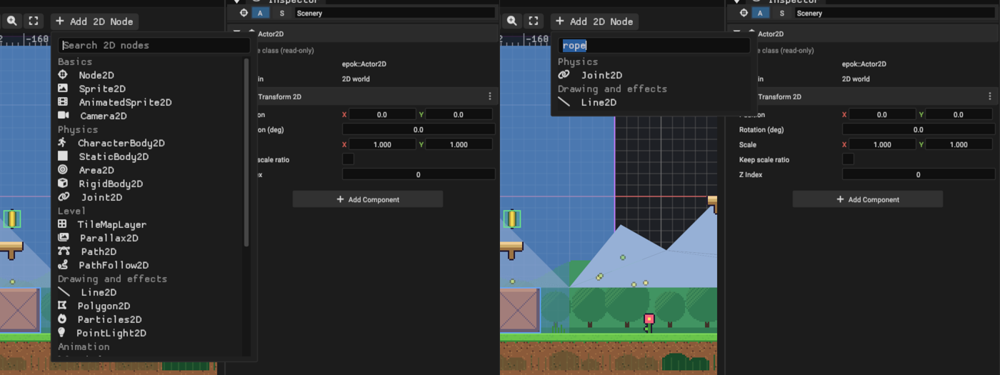
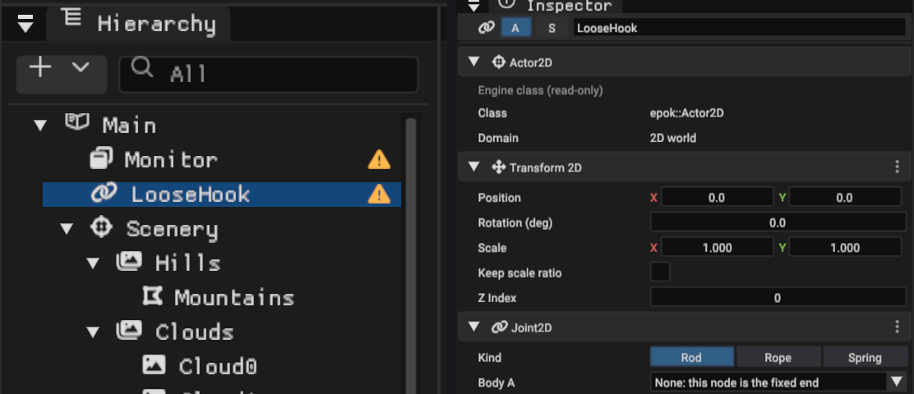
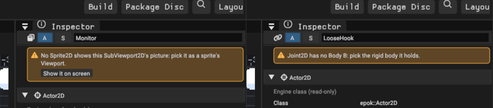
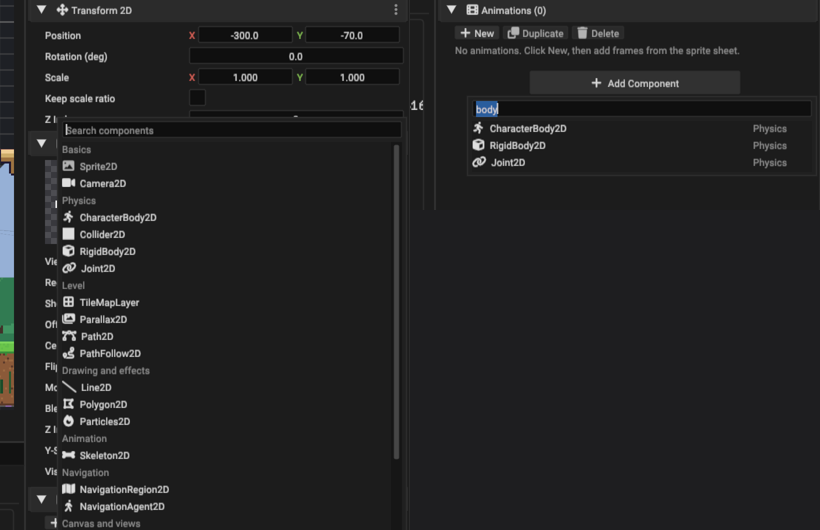
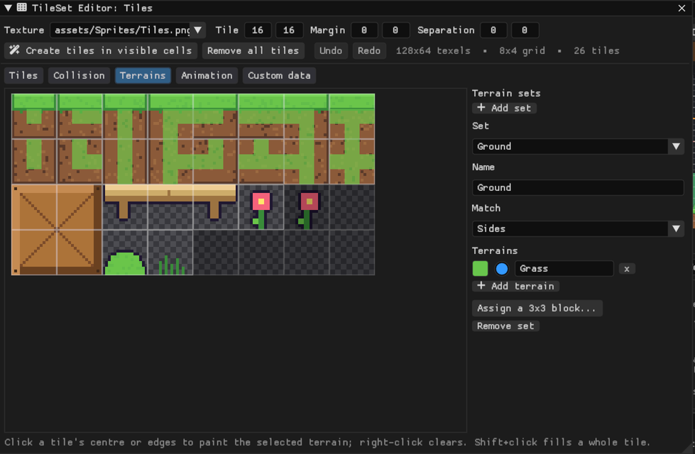
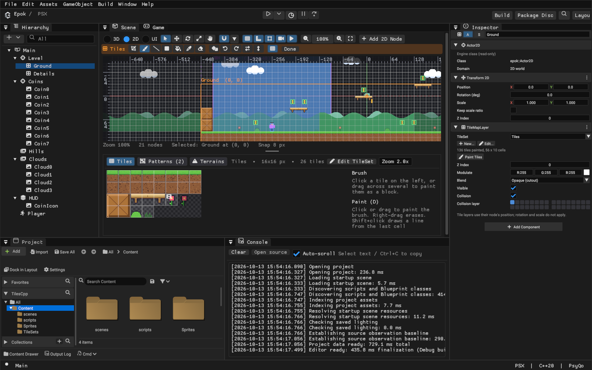
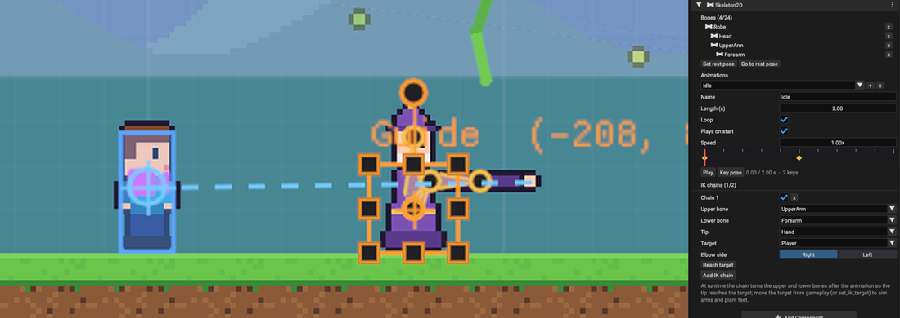
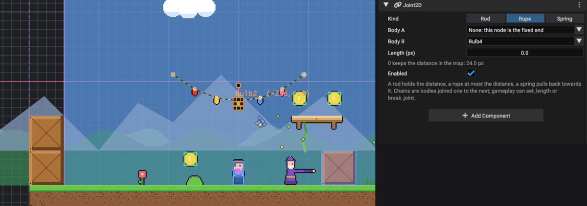
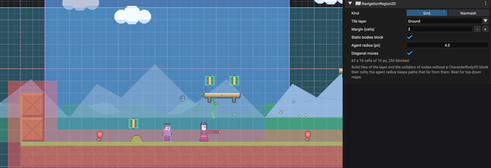
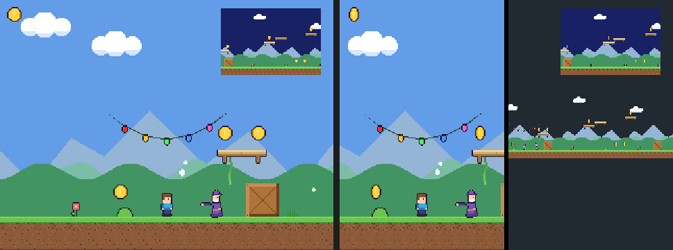

# 2D worlds

A map can hold a 2D world beside, or instead of, its 3D world. 2D content is made of
**2D nodes**: `Actor2D` actors whose root is a 2D transform, carrying engine
components such as Sprite2D, TileMapLayer, Collider2D, CharacterBody2D, Camera2D,
Parallax2D, Path2D, Line2D, Polygon2D and Particles2D, plus any C++, Blueprint or Lua
component of your own. On the PlayStation
the 2D world is drawn after the 3D world and before the HUD.

**Units are pixels with Y pointing down**, exactly like the screen and a texture: at
zoom 1 a 16 x 16 sprite covers 16 x 16 screen pixels, and positions, collider sizes,
velocities (pixels per second) and camera limits all use the same unit. Rotations are
degrees; a positive rotation turns clockwise on screen.

## Start here

- **New Project > Platformer 2D** creates a playable side-scroller at 320 x 240: an
  animated player that runs, jumps and pushes a crate, a following camera with level
  limits, a tile map painted from a TileSet, a lift that carries the player, and a
  layered, living world around it (see [The Platformer 2D template](#the-platformer-2d-template)).
  Its gameplay is written in the language you choose (C++, Blueprint or Lua); every
  flavor behaves identically.
- In any project, switch the Scene window to **2D** and use **Add 2D Node**, the
  Hierarchy's **2D Node** menu or the empty-view buttons. Dragging an imported texture
  from the Project panel into the 2D view creates a Sprite2D at the drop point.

## The Platformer 2D template

The template is a starting point, not a demo to keep: every part is an ordinary node,
grouped in the Hierarchy by what it is for, so whole groups can be deleted or reused.

| Group | What is in it |
| --- | --- |
| Scenery | **SkyLayer**: a gradient stretched over the screen and an additive sun, on a canvas behind everything. **Hills** with the polygon **Mountains** (half the camera's speed), drifting **Clouds**, a **Treeline** (0.7) and dark **Foreground** bushes scrolling faster than the camera, in front of everything |
| Level | **Ground** (solid and one-way tiles, crates) and **Details** (decoration) tile layers, a **Lift** riding **LiftPath**, a **Vine** (Line2D) and **WispPaths**, the navigation grid over the ground |
| Characters | the **Player** (CharacterBody2D, Camera2D and its controller script), the **Guide** (a Skeleton2D cut-out whose IK arm points at the player) and the **Wisp** (a NavigationAgent2D that follows the player round the tiles) |
| Props | a **PushCrate** (RigidBody2D the player pushes) and a **Garland** of light bulbs on rope joints with its cord drawn by a Line2D |
| Coins | spinning coins whose CoinPickup script hides them on contact |
| Effects | **Fireflies** over the meadow and falling **Petals** on a screen canvas of their own |
| HUD | a coin icon on a screen canvas, and a line of help (**HelpCanvas** / **ControlsHint**) at the top |

The artwork is generated pixel art in `assets/Sprites`: replace a PNG with your own and
the sprites using it follow (keep the sheet layout of Player.png and Tiles.png, or
re-slice them). The level is painted with the TileSet in `assets/TileSets`: select
**Ground** to paint, or open **Edit TileSet** to change tiles, collision and terrains.
The template's static RAM on the console is about 1.5 MiB of the 2 MiB, leaving room for
a game's own code and data; deleting the groups you do not use frees it.

## The 2D view

The Scene window's 2D mode is a pixel-accurate editor. When a map opens it frames
what the game camera will show. Sprites draw with their real textures, animations and
flips, colliders draw exactly as the console resolves them, and the current camera's
view is filled with its background colour.

| Tool | Key | What it does |
| --- | --- | --- |
| Select | Q | Click to select (topmost first), drag to move. The selection box has scale handles on its corners and edges, a rotation knob above it, and collider resize handles. |
| Move | W | Drag anywhere to move the selection. |
| Rotate | E | Drag around the pivot to rotate. Shift snaps to the rotation step. |
| Scale | S | Drag to scale from the pivot. Shift keeps the ratio. |
| Pan | Space (hold) | Drag to pan. Middle or right drag pans with any tool. |

| Action | Input |
| --- | --- |
| Zoom at the cursor | Mouse wheel, or the zoom buttons and presets in the toolbar |
| Frame the selection, or the whole map | F, or the frame button |
| Toggle snapping | G, or the magnet button; its arrow sets the grid and rotation steps. Hold Alt while dragging to ignore snapping |
| Nudge the selection | Arrow keys: 1 pixel, or one grid step with Shift |
| Duplicate / delete | Ctrl+D (Cmd+D) / Delete |
| Context menu | Right click: add a 2D node at the cursor, duplicate, delete, frame |
| Deselect | Escape |

The toolbar also toggles the grid, the pixel rulers, collision shapes, camera bounds
and animation previews. The status bar shows the cursor position in world pixels, the
zoom and the selection. Every edit is one Undo step, a whole drag included.

## 2D nodes

| Node | Components | Use it for |
| --- | --- | --- |
| Node2D | none | Grouping, positioning other nodes, script-only logic |
| Sprite2D | Sprite2D | A texture, a region of an atlas or one cell of a sprite sheet |
| AnimatedSprite2D | Sprite2D | Named frame animations |
| TileMapLayer | TileMapLayer | Levels painted from a TileSet, with tile collision |
| Camera2D | Camera2D | The view the game shows |
| CharacterBody2D | Sprite2D, Collider2D, CharacterBody2D | A player or enemy moved by script |
| StaticBody2D | Collider2D | Floors, walls, platforms |
| Area2D | Collider2D (trigger) | Pickups, damage zones, checkpoints |
| Parallax2D | Parallax2D | Backgrounds that scroll slower than the camera and repeat |
| Path2D | Path2D | Curves to move things along: patrols, rails, moving platforms |
| PathFollow2D | PathFollow2D | A node that travels along a Path2D and carries bodies standing on it |
| Line2D | Line2D | Ropes, vines, lasers, trails, outlines |
| Polygon2D | Polygon2D | Filled or textured shapes: distant scenery, shadows, terrain |
| Particles2D | Particles2D | Sparks, smoke, dust, rain, fireflies |
| PointLight2D | Sprite2D (additive) | Soft glows: lamps, torches, magic |
| CanvasLayer2D | CanvasLayer2D | HUD sprites and fixed layers drawn in screen pixels |
| CanvasModulate2D | CanvasModulate2D | Tinting a whole canvas: night, flashes, fades |
| AudioPlayer2D | AudioPlayer2D | Sounds that fade and pan with the camera |
| VisibleOnScreenNotifier2D | VisibleOnScreenNotifier2D | Knowing when a node enters or leaves the view; pausing it off screen |
| RemoteTransform2D | RemoteTransform2D | Making one node follow another without attaching it |
| Skeleton2D | Skeleton2D | Cut-out characters: parts animated as bones, with IK arms and legs |
| NavigationRegion2D | NavigationRegion2D | Where agents can walk: a grid from tiles and static bodies, or a navmesh |
| NavigationAgent2D | NavigationAgent2D | Enemies, NPCs and companions that find their way to a target |
| RigidBody2D | Sprite2D, Collider2D, RigidBody2D | Crates to push, balls, falling rocks, anything that bounces |
| Joint2D | Joint2D | Pendulums, ropes, chains, springs: a rigid body tied to a point or another body |
| SubViewport2D | SubViewport2D | A camera's view as a picture a sprite shows: minimaps, monitors, picture-in-picture |
| SplitScreen2D | SplitScreen2D | Two cameras on one screen, side by side or stacked: local multiplayer |

The Add 2D Node menus group these by purpose: Basics, Physics, Level, Drawing and
effects, Animation, Navigation, Canvas and views, and Audio and helpers. The toolbar's
**Add 2D Node** opens with the cursor in a search field and the project's **Recent**
nodes on top, so **Enter** repeats the last one. Type part of a name, a group or a
purpose ("rope", "minimap", "enemy", "physics") and the list narrows as you type, best
match first — names before groups before descriptions — with each result's group on the
right; **Enter** creates the first at the view's centre. Hovering a node explains what
it is for.



### Warnings and one-click fixes

A node that cannot do its job as set up shows an amber warning sign at the end of its
Hierarchy row; hovering the sign lists the reasons. Selecting it shows the same
reasons in an amber box at the top of its Inspector, with a button where the fix is
obvious. The sign disappears once the node is fixed, and a new project from a template
opens without any.

| Node | Warns when | Fix button |
|---|---|---|
| RigidBody2D, CharacterBody2D | It has no enabled, non-trigger Collider2D (a body hanging on a Joint2D may go without) | **Add a Collider2D**, fitted to the node's sprite |
| Joint2D | It has no Body B, or Body B has no RigidBody2D | — |
| SubViewport2D | No Sprite2D shows its picture | **Show it on screen**: a Sprite2D in the top-right corner of the HUD canvas (or at the node, without one) |
| SubViewport2D | Its Camera node has no Camera2D | — |
| SplitScreen2D | One of its two cameras is missing or has no Camera2D | — |
| NavigationAgent2D | The map has no NavigationRegion2D | **Add a NavigationRegion2D**: a grid over the solid tile layer with the most tiles |
| NavigationRegion2D | Its navmesh has fewer than three points, or its Tile layer node has no TileMapLayer | — |
| Skeleton2D | It has no bones, an IK chain lacks its tip or target, or a bone's node was deleted | — |
| PathFollow2D | It neither names a Path2D nor is attached to one | — |

A fix is one undo step and keeps the fixed node selected.





### Adding components and picking nodes

**Add Component** at the bottom of a 2D node's Inspector lists every 2D component in
the same groups as Add 2D Node, with the same search: a sprite becomes a falling crate
with **Add Component**, "rigid", **Enter**, then **Add a Collider2D** from its warning.
Components a node already has, and allows once, are greyed out. Scripts and shared
components follow the 2D ones.



Fields that pick a node (a joint's bodies, an agent's target, a picture's camera) or a
texture list only what fits; with more than eight choices the list opens with a search
field focused, so typing "player" and **Enter** picks the Player.

Nodes are ordinary actors: add or remove components in the Inspector, parent them for
grouping in the Hierarchy, convert them to Blueprint classes and spawn them at runtime.

## Sprite2D

- **Texture** and **Region**: pick an imported texture (or drop one on the preview).
  **Region...** opens a zoomable editor where you drag the rectangle to draw, snapped
  to pixels or to 4-32 pixel steps. Zero width/height uses the rest of the texture.
- **Sheet columns/rows** and **Frame** show one cell of a uniform sprite sheet.
- **Offset**, **Centered**, **Flip H/V**, **Modulate** (multiplies the texels; 255 is
  unchanged), **Blend** (opaque, 50% average, add, subtract, 25% add — the console's
  semi-transparency modes), **Z Index**, **Y-Sort** and **Visible**.
- **Animations**: named clips with a speed in frames per second, looping, a default
  animation and Autoplay. **Add Frames from Sheet...** cuts the texture into a grid
  (columns, rows, offset, separation); click cells in the order they should play.
  Each frame has a relative duration and an optional event id.

Draw order is: the owner's Z Index plus the sprite's Z Index, then, for Y-sorted
sprites, their world Y (lower on screen draws in front), then creation order.

## Collider2D

A **Rectangle** (size) or **Circle** (radius) with an **Offset**, in one of three
modes:

- **Solid** blocks CharacterBody2D motion.
- **Trigger** reports overlaps: the actor's **Overlap 2D** event and every component's
  **Trigger Event** receive the other actor with Enter, Stay or Exit.
- **One-way** is a platform that only stops bodies falling onto its top edge; a body
  jumping from below passes through. **One-way margin** lets a body that sank a few
  pixels still land.

**Layer** and **Mask** are 32-bit grids: two colliders interact when each one's layer
is in the other's mask. Shapes follow the owner's position and scale; boxes stay
axis-aligned when the node rotates. **Fit to Sprite** sizes the shape to the sprite.

## CharacterBody2D

Set the velocity in pixels per second and call **move_and_slide()** from tick. The
body moves through its actor's first solid Collider2D, slides along what it hits, zeroes
the velocity component pushing into an obstacle and updates **is_on_floor**,
**is_on_wall** and **is_on_ceiling** against **Up direction** (screen up by default)
and **Floor max angle**. **Floor snap length** keeps a grounded body on the floor when
it walks off a small step. **Floating** mode (top-down games) treats every contact as a
wall. **move_and_collide(dx, dy)** moves by an explicit displacement and stops.

## Camera2D

The current camera follows its actor. Per simulation step it applies **Drag margins**
(a dead zone the target can move in), **Limits** (the view never shows outside them;
**Fit Limits to Scene** measures the map), **Smoothing** and then **Offset** and
shake. **Zoom** magnifies, **Background** is the colour the game clears to when no 3D
camera paints one, and **Rotate with node** turns the view with its actor. Gameplay
can call **make_current**, **set_zoom**, **set_limits** and **shake(amplitude,
seconds)**.

## Tile maps

A **TileSet** is an asset that cuts one texture into a grid of tiles and stores what
each tile is: its collision, whether it is a one-way platform, its animation, its
terrain and any custom data. A **TileMapLayer** paints cells with the tiles of one
TileSet. Several layers can share a TileSet: a solid layer for the level and a
decoration layer without collision in front of or behind it, for instance.

### Creating a TileSet

1. Import the PNG that holds your tiles, laid out on a grid.
2. Add a **TileMapLayer** node (Add 2D Node, the Hierarchy or the right-click menu).
3. In the palette under the 2D view, or in the Inspector, choose **New TileSet from a
   texture...**, pick the texture and the tile size (8, 16, 24 or 32 pixels, or any
   size). A tile is created for every cell that has visible pixels, and the TileSet
   editor opens.

**Content Browser > Create > TileSet** makes an empty TileSet whose texture you choose in
the editor, and **Use an existing TileSet** assigns one the project already has.
16 x 16 tiles are the cheapest on the console (see below).

### The TileSet editor



Double-click a TileSet in the Content Browser, or press **Edit TileSet** in the palette
or the Inspector. The top bar sets the texture, tile size, margin and separation and
can create tiles for every cell with visible pixels. The atlas zooms with the mouse
wheel; every edit is saved at once and can be undone inside the window (Ctrl+Z,
Ctrl+Shift+Z). Maps that use the TileSet update immediately.

| Mode | What you do |
| --- | --- |
| Tiles | Click a tile to select it (Shift adds), click an empty cell to create a tile there, right-click a tile to remove it. The panel edits the selected tile: collision, one-way, probability and custom values. |
| Collision | Pick Full, a half (top, bottom, left, right) or None and click or drag across tiles; tick One-way for jump-through platforms. Right-click clears. A tile's shape can also be any rectangle. |
| Terrains | Add a terrain set and its terrains, then paint each tile's peering bits: the centre of a tile is its own terrain, its edges and corners the terrain it connects to. Shift+click fills a whole tile, right-click clears a zone. **Assign a 3x3 block** sets up a block laid out as an area's corners, edges and centre in one click. |
| Animation | Select a tile and set its frames (laid out to the right of it in the atlas, optionally wrapping after a number of frames per row) and speed. A live preview plays. |
| Custom data | Add integer or boolean layers (damage, friction, a footstep sound) and paint values onto tiles. Gameplay reads them with `get_cell_custom_data`. |

Terrain sets match **Corners and sides** (47-tile blob layouts), **Sides** (16 tiles)
or **Corners** (16 tiles). When a neighbourhood has no exact tile the closest one is
used, so an incomplete set still paints.

### Painting



Select a TileMapLayer: the tile tools appear under the 2D toolbar and the palette opens
under the view (drag the bar above it to resize). The layer being painted is drawn at
full strength and other tile layers are dimmed.

| Tool | Key | What it does |
| --- | --- | --- |
| Select cells | S | Drag a rectangle of cells. Ctrl+C copies it to the brush, Delete erases it, and the Patterns tab saves it as a pattern |
| Paint | D | Click or drag to paint the brush. Shift+click draws a line from the last painted cell |
| Line | L | Drag a straight line |
| Rectangle | R | Drag a filled rectangle; a multi-tile brush repeats across it |
| Bucket fill | B | Fill the connected area of the same tile; untick Contiguous to replace every matching cell |
| Pick tile | P | Click a painted cell to load its tile (and flips) into the brush |
| Eraser | E | Click or drag to erase |

| Action | Input |
| --- | --- |
| Erase with the current tool's shape | Right-drag |
| Random scatter: one random tile of the brush per cell, weighted by tile probability | G, or the dice button |
| Rotate the brush left / right | Z / X |
| Flip the brush horizontally / vertically | C / V |
| Pan | Middle drag, or Space and drag |
| Stop painting and move nodes again | Q, Esc or **Done** |

The palette has three tabs:

- **Tiles**: click a tile, or drag across several to paint them as a block. Ctrl+wheel
  zooms; hovering a tile tells you what it is.
- **Patterns**: reusable blocks of tiles saved with the TileSet (a tree, a house, a
  platform). Click one to paint it; right-click to rename or delete.
- **Terrains**: pick a terrain and paint, draw lines or rectangles or fill; edges and
  corners connect to their neighbours automatically, and erasing a terrain updates the
  cells around it. **Erase terrain** removes cells of that set.

The status bar shows the cell under the mouse and its tile. Every stroke is one Undo
step.

### Tile collision

Tiles with collision block CharacterBody2D bodies, rays and overlap queries exactly
like box colliders, and one-way tiles behave like one-way platforms; a body slides
across the seams between tiles without catching. The layer's **Collision** toggle and
**Collision layer** decide which bodies it blocks (a body's mask must include the layer).
After a collision with a tile, the body's `last_collision_actor` is the tile layer's
actor and `last_collision_is_tile`, `last_tile_x` and `last_tile_y` name the cell.

### Tile maps in gameplay

| Function | Use |
| --- | --- |
| `world_to_map_x/y(world)`, `map_to_world_x/y(cell)` | Convert between world pixels and cells (cell centres) |
| `get_cell_atlas_x/y(x, y)`, `is_cell_empty`, `is_cell_solid` | Inspect a cell |
| `get_cell_custom_data(x, y, layer)` | Read a custom data value |
| `set_cell(x, y, atlas_x, atlas_y)`, `set_cell_flipped(...)`, `erase_cell(x, y)` | Change cells at runtime: break blocks, open doors, collect tiles |
| `set_visible`, `set_collision_enabled`, `set_modulate`, `set_z_index` | Change the whole layer |

Runtime changes live in a table of up to 128 cell edits per map; loading the map again
restores the painted tiles.

## Parallax2D

A Parallax2D moves its node, and everything attached to it, at a fraction of the
camera's speed: **Scroll scale** 1 moves with the world, 0.5 is a distant layer, 0 stays
on screen (a sky). **Autoscroll** adds a constant drift, for clouds or water. With a
**Repeat size** the attached sprites and tile layers repeat every that many pixels to
fill the screen; **Repeat Sprite Horizontally** uses the width of the node's own sprite.
The layer appears where you placed it when the game camera is at its starting view, and
scrolls from there. In the editor, repeated copies are drawn faded.

## Paths and moving platforms

A **Path2D** is a curve made of points. Select it and edit it directly in the view:

| Action | Input |
| --- | --- |
| Move a point | Drag it (snapping applies; Alt ignores it) |
| Insert a point | Click the small dot halfway along a segment, then drag |
| Add a point at the end | Ctrl+click (Cmd+click) empty space, or the Add mode of the Points row |
| Delete a point | Right-click it, the Delete mode, or select it and press Delete |
| Bend a segment | Select a point and drag its curve handles (Shift moves one handle alone); **Smooth curve** adds handles through every point, **Straighten** removes them |

The Points row under the toolbar switches between editing, adding and deleting and
opens or closes the path. An arrow halfway along shows the direction followers travel.

A **PathFollow2D** moves its node along a path: the Path2D of the node it is attached to,
or the one chosen in **Path**. **Speed** advances **Progress** (pixels along the path)
every step; at the ends it loops, ping-pongs or stops; **Offset** shifts it along and
across the path, and **Rotate along path** turns the node with the curve. In the editor
a ring marks where the node starts on its path. Bodies standing on a moving node's
solid or one-way collider ride along, so a PathFollow2D with a Collider2D is a moving
platform. Gameplay reads and sets the progress (`set_progress`, `set_progress_ratio`),
the speed and whether it moves.

## Lines and polygons

A **Line2D** draws a polyline: **Width**, a colour that blends from **Start colour** to
**End colour**, open or closed, with any blend mode. Its points are edited like a
path's. Gameplay can move, add, remove and clear points at runtime (up to 32), which
suits ropes, grappling hooks and lasers. Under **Follow nodes** a line instead runs
through up to 16 nodes in order and follows them while the game runs: the cord of a
rope of rigid bodies, a chain, a beam between two moving things (`stop_following`
freezes it where it is).

A **Polygon2D** fills a shape with a colour, or with a texture placed by **Texture
offset** (texels drawn at the node's origin). Any outline that does not cross itself
works, concave ones included; an invalid outline shows in red until a point is moved.

## Particles2D

A CPU particle emitter. **Amount** particles live **Lifetime** seconds each, spawned as
a steady stream (**Explosiveness** 0) or all at once (1), once (**One shot**) or
forever. They leave a point, a rectangle or a circle, in **Direction** within **Spread**
degrees at a random speed between the two **Speed** values, fall with **Gravity**, slow
down with **Damping**, scale from start to end and blend from **Start colour** to **End
colour**. Each particle draws a texture **Region** (a small dot or spark), optionally
cycling **Frames** across it over its life. **Local coordinates** make particles move
with the node. The presets (Sparks, Smoke, Rain, Dust) are good starting points. The 2D
view previews the emitter while animation preview is on.

Gameplay restarts a burst with `restart`, toggles a stream with `set_emitting`, counts
live particles and learns when a one-shot burst ended (`take_finished`). Every emitter
of a map shares one particle pool, sized from the maps when the game is built.

## PointLight2D

A PointLight2D is a Sprite2D drawing a soft radial texture (generated in
`assets/Sprites/Light2D.png` the first time) with additive blending: it brightens what is
behind it. Scale it to set its size and use **Modulate** for its colour and strength.

## AudioPlayer2D

Plays a clip whose loudness and stereo position follow the current camera: full volume
at the centre of the view, silent at **Max distance**, fading linearly or faster
(**Attenuation**), and panned towards its side of the screen (**Panning**). `play`,
`stop`, `set_volume`, `set_pitch` and `set_clip` control it from gameplay.

## Notifiers and remote transforms

A **VisibleOnScreenNotifier2D** watches a rectangle around its node (**Fit to Sprite**
sizes it) and reports `is_on_screen`, `take_screen_entered` and `take_screen_exited`.
With **Pause node off screen** its node is deactivated while the rectangle is outside
the view: enemies and machinery that only run near the player.

A **RemoteTransform2D** copies its node's world position, rotation and/or scale onto a
**Target** every step, so a node can follow another (a weapon following a hand) without
being attached to it.

## Cut-out characters (Skeleton2D)

A cut-out character is drawn in parts — robe, head, upper arm, forearm, hand — each a
Sprite2D node attached to the part it hangs from. A **Skeleton2D** on the node above
them animates those parts as bones. Nothing about the parts changes: they are still
ordinary nodes, posed with the view's move and rotate tools, and every component works
on them.



1. Draw each part so it turns about its joint: a limb usually starts at its node's
   origin and extends along +X (untick **Centered** and set the offset to half its
   height), while a torso or a head stays centred.
2. Attach the parts to each other in the Hierarchy and place them in their rest pose.
3. Add a **Skeleton2D** node (Add 2D Node > Animation), attach the root part to it and
   press **Use the attached parts as bones**. The parts' current transforms become the
   **rest pose**; **Set rest pose** captures it again and **Go to rest pose** returns to
   it.
4. Add an animation with **+**, give it a length, then pose the bones and press **Key
   pose** at each time on the timeline. A key records every bone's rotation and
   position. Click a key's diamond to go to it, drag the time line to scrub (the bones
   take the pose, so a key is edited by going to it, posing and keying again), and
   **Play** to preview without touching the map's undo history.

Selecting a bone shows the same timeline in its own Inspector, so the usual loop is:
select a part, rotate it, **Key pose**. Between keys the skeleton blends each bone's
rotation along the shorter arc and its position in a straight line; a looping
animation blends its last key back into the first.

**IK chains** (up to two) turn an upper and a lower bone after the animation so a
**Tip** — the part at the end of the lower bone, a hand or a foot — reaches a
**Target** node, with the elbow or knee on the **Right** or **Left** of the line from
the upper joint to the target. Out of reach, the chain points straight at the target.
**Reach target** applies the same solve once in the editor, which is a quick way to
pose a limb before keying it. The Platformer 2D template's guide points at the player
this way while its idle animation plays.

Gameplay controls a skeleton through `Skeleton2DComponent`: `play(index)`, `stop`,
`seek`, `set_speed`, `take_finished` (once after a one-shot animation ends),
`reset_pose`, `set_ik_enabled` and `set_ik_target`. **Plays on start** starts an
animation with the map. A skeleton holds up to 24 bones, 16 animations of up to 64
keys and two IK chains; keys are cooked as constants (12 bytes per bone per key) and a
Skeleton2D component takes 224 bytes on the console.

## Rigid bodies and joints

A **RigidBody2D** falls, bounces, slides and gets pushed. Its shape is the node's solid
Collider2D (a box or a circle), and it collides with tiles and colliders exactly like a
CharacterBody2D's `move_and_slide`, so it never tunnels through a wall.



- **Mass** decides how momentum is shared when bodies run into each other and how
  slowly a character pushes it. **Bounce** is the restitution (0 stops dead, 1 bounces
  back at full speed), **Friction** slows sliding along what it touches, **Damping**
  slows it in the air, and **Gravity** is its own, in pixels per second squared.
- **Pushable** bodies are pushed by characters walking into them; heavier ones move
  slower. **Frozen** bodies stay put and block like a static body until gameplay
  unfreezes them (a crate that drops when a switch is hit). **Can sleep** lets a body
  that has come to rest stop costing anything until something hits or pulls it.
- Circles **roll**: the node turns as the ball moves along a floor. Boxes slide and
  stack but keep their rotation — the solver is axis-aligned, which keeps it exact and
  stable for the few dozen bodies a scene holds on the console.

Gameplay calls `apply_impulse`, `apply_force` (for one step), `set_velocity`,
`set_frozen` and `wake`, and reads the velocity, `is_sleeping`, `is_touching`, and
`take_contact` with `get_impact` (once per new contact, with its speed: a landing
sound).

A **Joint2D** ties **Body B**, a rigid body, to **Body A** — another node — or, with
no Body A, to the joint node's own position:

- **Rod** keeps the distance exactly (a pendulum, a lever);
- **Rope** keeps at most the distance (it goes slack);
- **Spring** pulls back towards the distance with **Stiffness** and **Damping**.

**Length** 0 keeps the distance the two ends have in the map, so posing the bodies is
how a rope is measured. Chains are bodies each joined to the previous one. The view
draws every joint while colliders are shown: a rod as a line, a rope dashed, a spring
as a zigzag, a fixed end as a square. Gameplay can `set_length`, disable a joint or
`break_joint` it for good. Joints do not draw at runtime; a Line2D that follows the
same nodes draws the rope. The Platformer 2D template shows both: a crate to push, and
a garland of light bulbs on rope joints whose cord is such a line.

## Navigation

A **NavigationRegion2D** describes where agents can walk, and a **NavigationAgent2D**
finds a path to a target and walks it.



A region is one of two kinds:

- **Grid** — a grid of cells, best for top-down maps and anything flying. Pick a
  **Tile layer** and the grid follows its cells (plus a **Margin** of free cells around
  the painted area): its solid tiles block, one-way tiles do not. Without a tile layer
  the grid covers an **Area** from the region node with cells of **Cell size**. With
  **Static bodies block**, the colliders of nodes without a CharacterBody2D (walls,
  crates) block the cells they cover. **Agent radius** keeps paths that far from
  anything blocked; **Diagonal moves** allows diagonal steps, never squeezing between
  two blocked corners. The Inspector shows the grid's size and blocked cells, and the
  view draws them in red.
- **Navmesh** — an outline, edited in the view like a Polygon2D, that agents walk
  anywhere inside in straight lines turning at its corners. It suits rooms, roads and
  caves without obstacles inside; use a grid for those. A region holds up to 64
  outline points.

Regions are cooked where they are placed: moving a region at runtime does not move its
navigation, and its cells do not change while the game runs. `set_enabled(false)` takes
a region out of planning. Agents plan inside the region they stand in, so paths do not
cross from one region into another.

An agent plans in the region under it, then walks: with **Moves the node** it drives
its node's CharacterBody2D through `move_and_slide` (set the body to **Floating** for
top-down movement) or moves the node directly when it has no body. Give it a
**Target** node to follow — it plans again every **Repath every** seconds while the
target moves — or call `set_target_position` from gameplay. **Arrive distance** is how
close counts as there. When the target cannot be reached, the agent walks to the
closest reachable point; `is_target_reachable` tells which. Selecting an agent draws
the path it would take now, green when it reaches its target and orange when it stops
short.

Gameplay reads `is_navigation_finished`, `take_arrived` (once on arrival),
`get_velocity_x/y` and `get_next_x/y` (to steer a body itself with **Moves the node**
off), and calls `set_target_actor`, `set_target_position`, `stop` and
`set_max_speed`. The Platformer 2D template's wisp is a navigation agent on a grid
over the Ground layer, following the player round the solid tiles.

On the console a grid costs one bit per cell, and the planner's scratch — 3 bytes per
cell of the largest grid plus its open list — is reserved only when a map has one. A
path holds up to 32 waypoints, and the whole map plans at most one path per step, so
a crowd of agents spreads its planning over several frames.

## Pictures and split screen



A **SubViewport2D** draws the world through a **Camera** — or the active camera — into a
picture of its own, and a **Sprite2D** whose **Viewport** names it shows that picture
instead of a texture. The sprite is an ordinary sprite: place it on a CanvasLayer2D for
a minimap in a corner of the screen, in the world for a security monitor, scale it,
tint it or blend it. A camera used only for a picture should not be **Current**.

- **Size** is the picture in pixels (the width rounds up to 16, at most 256 x 256). It
  is 15-bit colour in VRAM, 2 bytes a pixel, placed by the texture packer in a page of
  its own; the Inspector shows its cost.
- **Background** fills the picture before each redraw, and **Redraw every** draws it
  only every few frames: a minimap at every second frame costs half as much.
- **Draws** can limit the picture to one canvas layer, and **Hide layer elsewhere**
  removes that layer from every other view. A sprite showing the picture then draws the
  whole layer as one image — semi-transparent as a whole, without parts overlapping
  each other, which is what a canvas group is for.

The picture is drawn every frame on the console before the views that show it, so a
sprite always shows the current frame. In the editor a sprite showing a picture is a
framed stand-in, and selecting the SubViewport2D draws the area its camera frames.

A **SplitScreen2D** shows two cameras at once, **Side by side** or **Stacked**, with a
**Divider** of the chosen width and colour. Each half is drawn through its camera,
clipped to the half, over its camera's background; screen canvases (the HUD) are drawn
once over both. Give each player a CharacterBody2D with its own Camera2D and point the
split screen at the two of them. Gameplay can `set_enabled` and `set_side_by_side`; a
SubViewport2D can `set_camera`, `set_interval` and be switched off, and a sprite can
`set_viewport`.

## Colliders from sprites

Besides **Fit to Sprite**, a Collider2D can **Fit to Visible Pixels**: a box around the
sprite frame's opaque texels, ignoring its transparent margins.

## Canvas layers

Everything draws on a canvas. The world is canvas 0; a **CanvasLayer2D** puts its node
and everything attached to it on another canvas, drawn behind the world (negative
layers) or in front of it (positive). In **Screen** space the attached nodes are placed
in screen pixels (0, 0 is the top-left corner) and ignore the camera, which suits HUD
sprites; in **World** space they follow the camera but keep their own drawing order. The
editor outlines the screen area.

A **CanvasModulate2D** multiplies the colour of everything on its canvas (255 leaves it
unchanged); presets cover day, dusk, night and caves, and `set_color` animates it.

## Scripting

Every engine 2D component exposes its operations to C++, Blueprint and Lua through
the same reflection, and `World 2D` gameplay functions add **raycast_2d** and
**overlap_box_2d** queries.

```cpp
class EPOK_CLASS(Blueprintable, Domain=World2D, Owners=World2D, Id="...") Mover : public epok::ActorComponent {
public:
    EPOK_PROPERTY(EditAnywhere) epok::Fixed speed = 96.0;
    void tick(epok::Fixed dt) override {
        auto* body = epok::world2d::find<epok::CharacterBody2DComponent>(get_owner());
        if (!body) return;
        epok::Fixed vx = 0.0;
        if (epok::input.held(epok::Button::Right)) vx += speed;
        if (epok::input.held(epok::Button::Left)) vx -= speed;
        body->set_velocity(vx, body->velocity_y() + epok::Fixed(720.0) * dt);
        body->move_and_slide();
    }
};
```

```lua
local Mover = epok.ActorComponent:extend()
Mover.body = epok.ComponentRef(epok.CharacterBody2DComponent)
Mover.speed = 96.0
function Mover:tick(delta_seconds)
    local vx = 0.0
    if epok.input.held(5, 0) then vx = vx + self.speed end
    if epok.input.held(7, 0) then vx = vx - self.speed end
    self.body:set_velocity(vx, self.body:velocity_y() + 720.0 * delta_seconds)
    self.body:move_and_slide()
end
return Mover
```

Tile layers are scripted the same way. Breaking the block a body hits from below:

```cpp
auto* body = epok::world2d::find<epok::CharacterBody2DComponent>(get_owner());
if (body && body->is_on_ceiling() && body->last_collision_is_tile()) {
    auto* map = epok::active_object_registry->resolve<epok::Actor>(body->last_collision_actor());
    if (auto* tiles = epok::world2d::find<epok::TileMapLayerComponent>(map))
        tiles->erase_cell(body->last_tile_x(), body->last_tile_y());
}
```

The same functions, with the same names, are available to Lua and Blueprints.

In Blueprints, add a `ComponentRef` variable of the component class, set it in the
Inspector and call the component's functions on it. The Platformer 2D template's
`PlatformerController` and `CoinPickup` show the complete pattern in all three
languages.

## On the console

- A sprite that is neither rotated, scaled nor flipped, seen through an unrotated
  camera at zoom 1, is drawn as a hardware rectangle with exact texels; anything else
  becomes a textured quad. Sprites outside the screen are skipped.
- Lines draw as Gouraud-shaded quads (square caps close their corners), polygons as
  flat or textured triangles, and particles like sprites; a Parallax2D repeats lines and
  polygons as well. The 2D particle pool, line segments and polygon triangles are sized
  into the cooked packet budget.
- Tile layers draw only the cells on screen. Unflipped 8 x 8 and 16 x 16 tiles use the
  GPU's fixed-size rectangles, its cheapest primitive (16 bytes each); other sizes use
  sized rectangles, and flipped or rotated tiles and zoomed or rotated cameras use
  textured quads. A layer cooks only the 16 x 16-cell chunks that hold tiles.
- The build sizes the 2D service from the content of every map and Blueprint template
  (colliders, sprites and packet memory), and a project without 2D content compiles
  none of it.
- 2D games are usually best at **320 x 240**: four times fewer pixels to fill than
  640 x 480, and the framebuffers leave about 320 KiB more VRAM for textures.
- Play on Native PC draws the same 2D frame as the console (lines take one colour per
  segment there). It plays 2D audio at the volume it had when it started, without
  panning.

Current limits: boxes ignore rotation for collision, and rigid boxes slide and stack
without tumbling (the solver is axis-aligned; circles roll). A map's sprites,
colliders and packets must fit the cooked capacities (extra work is dropped and
counted, never overwritten). Tile layers use their node's position but not
its rotation or scale, a TileSet uses one atlas texture, tile collision shapes are
rectangles (no slopes yet), rotating tiles needs square tiles, and tile layers do not
y-sort with sprites. Collision shapes are boxes and circles: there are no polygon
colliders, so fit a box to the visible pixels instead.
