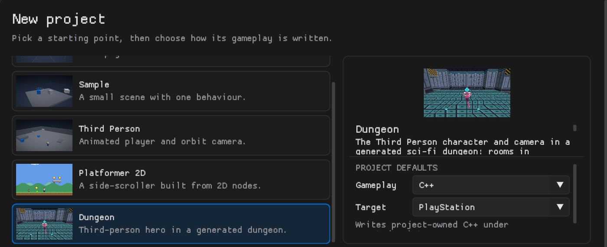
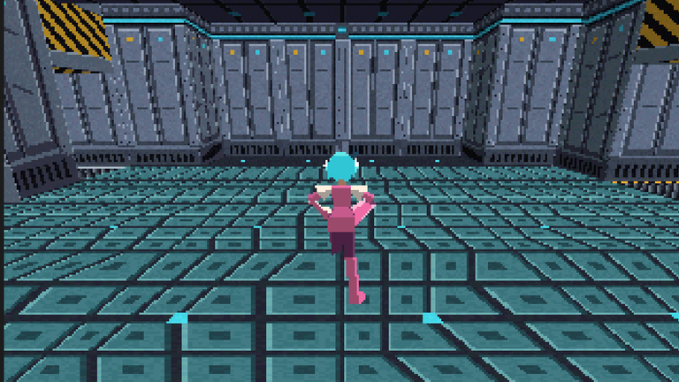
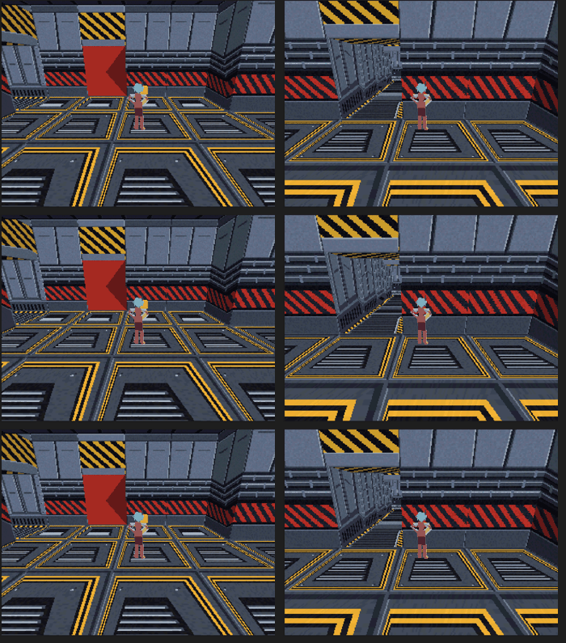

# Dungeon template

Choose **New project > Dungeon** in the Hub, or use:

```powershell
cargo run --locked -- --create-project "D:/Games/Dungeon" --template dungeon
cargo run --locked -- --create-project "D:/Games/Dungeon" --template dungeon --gameplay lua
```



The project starts with the [Third Person](third-person.md) character and orbit camera
in a dungeon made by the [Dungeon Generator](dungeons.md): the project's recipe (the
built-in route: a main path to the goal, cave branches with treasure, a loop, one-way
shortcuts, rooms on three floor levels and a locked door whose key waits on a branch;
plus one handmade room on the loop) dressed in the built-in sci-fi style (rooms in three
floor and wall finishes, columns along the walls, a ceiling, everything sized to the
character). Lighting is baked when the project is created, so Play works straight away.



## Playing

- Left stick or WASD moves relative to the camera, the right stick or mouse orbits it,
  Cross or K jumps.
- The dungeon climbs: corridors between rooms on different levels hold flights of
  stairs, walked up and down like any floor.
- One room of the loop is the Reactor, a [handmade room](dungeons.md#handmade-rooms):
  a core under a cyan light, four consoles and doorways on every side, turned to meet
  its corridors.
- The character starts in the spawn room. Walk into the gold key to pick it up: the
  red door it opens disappears, wherever it is. Only the character picks keys up: the
  generator's **Player** is set to it, and each key names it.

## Making it yours

Select **Dungeon** in the Hierarchy; its Dungeon Generator band is in the Inspector.

- **New seed** builds another dungeon from the same recipe and style. **Generate**
  rebuilds after any change. Both are one undo step.
- **Test seeds...** measures hundreds of seeds against the console's budget before you
  pick one; the template's recipe stays within it on every seed tried, at up to about
  3,400 of the 3,500 quads.
- Press **New** beside **Recipe** for an editable copy of the route: longer paths, more
  branches, more keys and locks, caves on other paths.
- Press **New** beside **Style** for an editable copy of the look: add meshes, lights or
  your own actors on any spot, change the texture variants and columns.
- Build rooms of your own: the Reactor is built in
  `assets/Dungeons/Rooms/Workbench.epokmap`. Open it, change the room under the
  **Reactor** actor and press **Update from selection** in its Dungeon Room editor, or
  build another room beside it and save it with **GameObject > Save Selection as
  Dungeon Room...**. The recipe (`assets/Dungeons/Recipes/Dungeon.epokasset`) makes one
  loop room from the Reactor; its **Handmade rooms** step takes more rooms, more paths
  or a higher **At most**.
- Open **Minimap** in the band and tick it for a map in the corner of the screen that
  fills in as the character explores (about 9 KB of the console's RAM). See
  [Minimap](dungeons.md#minimap).
- The band's meter shows the console budget the map will use (actors, quads,
  collision, navigation). The template leaves room to grow: about 1.9 MiB of the
  console's 2 MiB of RAM are used (C++ 1.89 MiB, Lua 1.91 MiB, Blueprint 1.92 MiB).

## Gameplay flavors

The choice at creation decides which language the starter gameplay is written in; the
project can use all three afterwards.

| Flavor | Character | Key and door |
| --- | --- | --- |
| C++ (recommended) | `assets/scripts/ThirdPersonController.hpp` | `assets/scripts/DungeonKey.hpp`, `DungeonDoor.hpp` |
| Blueprint | `assets/Blueprints/ThirdPersonController.epokbp` | `assets/Blueprints/DungeonKey.epokbp`, `DungeonDoor.epokbp` |
| Lua | `assets/scripts/ThirdPersonController.lua` | `assets/scripts/DungeonKey.lua`, `DungeonDoor.lua` |

Fresh projects share PickupComponent and DoorComponent in all three languages.
The key's `accepted_initiator` names the player and `auto_collect` enables pickup
on entering its trigger. `collected_flag` names a GameplayFlagComponent on the key;
the project's `collected` callback hides the actor after ownership is committed.
The door's `requirement_flag` reads that same component, independently of the key's
visibility. Its project tick requests opening and calls the parent tick to apply
the state/collider transition; `door_changed` implements the visual result.

The generated `lock_id` property stores the recipe lock number. Its name avoids
colliding with the shared door's `lock()` operation. Collider references and
key-state component identities are explicit. Template roles `key`, `door` and
`key_state` select the classes by UUID and survive renaming or compatible
replacement.

Existing project sources are preserved, including unchanged older versions.
Their legacy `lock`/`player`/`key` contract remains supported during regeneration;
placing a helper does not implicitly migrate code and saved properties. New
class installation also preserves existing Lua class identities.

C++ is the default; Blueprint provides editable visual graphs and Lua provides
editable scripts. The generator consumes the project's recorded class roles.


