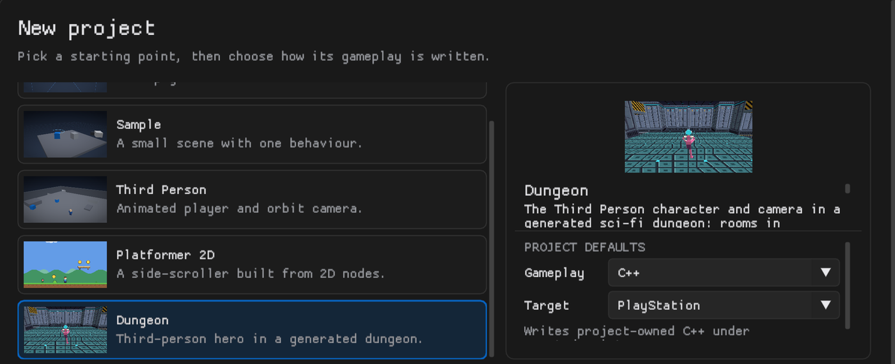
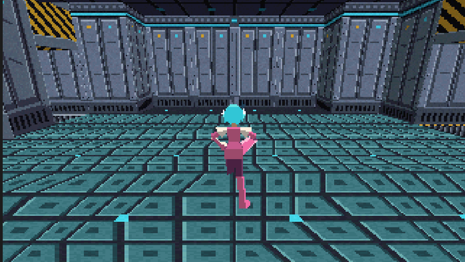
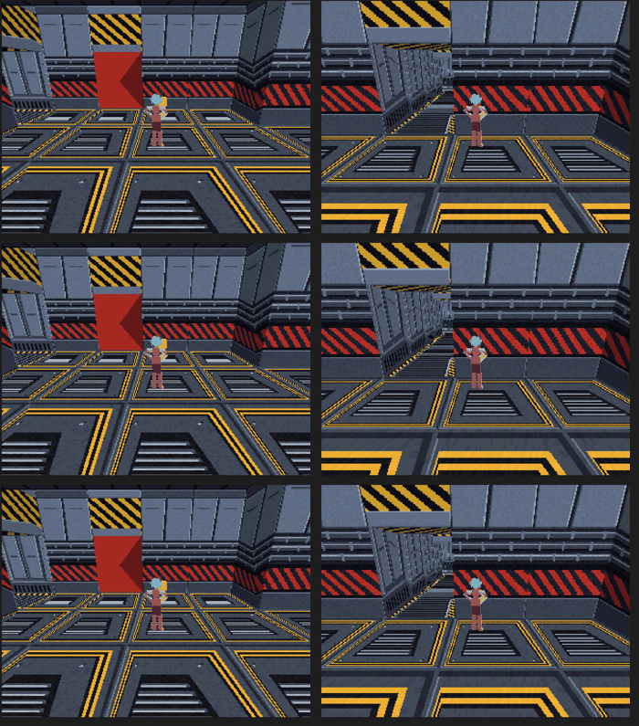

# Dungeon template

Choose **New project > Dungeon** in the Hub, or use:

```powershell
cargo run --locked -- --create-project "D:/Games/Dungeon" --template dungeon
cargo run --locked -- --create-project "D:/Games/Dungeon" --template dungeon --gameplay lua
```



The project starts with the [Third Person](third-person.md) character and orbit camera
in a dungeon made by the [Dungeon Generator](dungeons.md): the built-in recipe (a main
path to the goal, cave branches with treasure, a loop, one-way shortcuts, and a locked
door whose key waits on a branch) dressed in the built-in sci-fi style (rooms in three
floor and wall finishes, columns along the walls, a ceiling, everything sized to the
character). Lighting is baked when the project is created, so Play works straight away.



## Playing

- Left stick or WASD moves relative to the camera, the right stick or mouse orbits it,
  Cross or K jumps.
- The dungeon climbs: corridors between rooms on different levels hold flights of
  stairs, walked up and down like any floor.
- The character starts in the spawn room. Walk into the gold key to pick it up: the
  red door it opens disappears, wherever it is. Only the character picks keys up: the
  generator's **Player** is set to it, and each key names it.

## Making it yours

Select **Dungeon** in the Hierarchy; its Dungeon Generator band is in the Inspector.

- **New seed** builds another dungeon from the same recipe and style. **Generate**
  rebuilds after any change. Both are one undo step.
- Press **New** beside **Recipe** for an editable copy of the route: longer paths, more
  branches, more keys and locks, caves on other paths.
- Press **New** beside **Style** for an editable copy of the look: add meshes, lights or
  your own actors on any spot, change the texture variants and columns.
- The band's meter shows the console budget the map will use (actors, quads,
  collision, navigation). The template leaves room to grow: about 1.8 MiB of the
  console's 2 MiB of RAM are used.

## Gameplay flavors

The choice at creation decides which language the starter gameplay is written in; the
project can use all three afterwards.

| Flavor | Character | Key and door |
| --- | --- | --- |
| C++ (recommended) | `assets/scripts/ThirdPersonController.hpp` | `assets/scripts/DungeonKey.hpp`, `DungeonDoor.hpp` |
| Blueprint | `assets/Blueprints/ThirdPersonController.epokbp` | `assets/Blueprints/DungeonKey.epokbp`, `DungeonDoor.epokbp` |
| Lua | `assets/scripts/ThirdPersonController.lua` | `assets/scripts/DungeonKey.lua`, `DungeonDoor.lua` |

All three behave the same: a key deactivates its actor the first time the actor its
`player` property names enters its trigger; a door deactivates once the key actor its
`key` property names is no longer active. C++ is the default because it is the most
direct to read and change, and the lightest on the console; Blueprint suits visual
editing, Lua short scripts. The generator keeps using the flavor the project holds
when it places keys and doors.


