# Dungeon Generator

A Dungeon Generator lays out rooms, corridors and doors from a seed and bakes the
result into the map as ordinary Epok content. Rooms are either scattered over a grid
or grown by a [Dungeon Recipe](#dungeon-recipes): a designed route from spawn to goal
with branches, loops, items, keys and locks, and one-way doors. The same seed and settings always
produce the same dungeon, so what you see in the editor is exactly what ships: the
console runs the baked map and does no generation work of its own.

| Output | 3D generator | 2D generator |
| --- | --- | --- |
| Floors and walls | EditableMesh sections under `assets/Dungeons/<name>/` | One TileMapLayer painted with Floor and Wall terrains |
| Collision | One compound collider holding every floor, wall and doorway box | The TileSet's tile collision |
| Navigation | Navigation bake volumes over the floor, spaced for the node budget | — |
| Gameplay points | `Spawn` and `Goal` actors at the centres of the spawn and goal rooms | `Spawn` and `Goal` Node2D actors |
| Keys, locks, items | Spots for the style: blockout markers by default, or your own actors | Spots for the style: marker tiles by default, or your own actors |
| Look | A [Dungeon Style](#dungeon-styles): the built-in sci-fi panels with a ceiling, or meshes, lights and actors | A Dungeon Style: the built-in tiles, or any TileSet's terrains and tiles |

## Create a dungeon

- **3D:** choose **GameObject > Dungeon Generator**, or the same entry in the
  Hierarchy's create menu.
- **2D:** choose **Add 2D Node** and search for `DungeonGenerator` (group *Level*).

The generator appears at the map origin (3D) or at the centre of the 2D view, generates
a first dungeon straight away and frames the Scene view on it. The generated actors
are children of the generator, so moving the generator moves the whole dungeon.

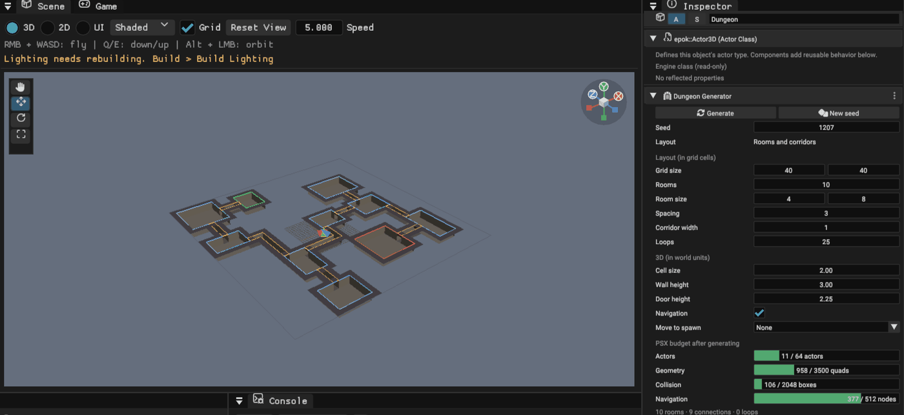

## The Dungeon Generator band

Select the generator to edit it in the Inspector.

- **Generate** rebuilds the dungeon from the current settings. **New seed** picks
  another seed and generates. Both are one undo step: **Ctrl+Z** brings back the
  previous dungeon.
- While the generator is selected in 3D, the Scene view draws its layout: the grid
  outline, rooms (spawn green, goal red), corridor walls and doors. Before the first
  generation, or when the settings changed, the outline lies on the floor; afterwards
  it floats just above the walls.
- An amber box lists anything that needs attention, with a button where there is an
  obvious fix: nothing generated yet, settings changed since the last generation, a
  rotated or scaled generator, rooms that did not fit, or a budget overrun.
- The three-dot menu holds **Remove generated content** (the generator keeps its
  settings) and **Reset settings**.

### Layout settings

**Layout** chooses where the rooms come from: **Rooms and corridors** scatters rooms
over a grid with the settings below; **Recipe** follows a [Dungeon Recipe](#dungeon-recipes)
and replaces them with a **Recipe** row (built-in recipe or any recipe asset, with
**New** and **Edit** like the style row).

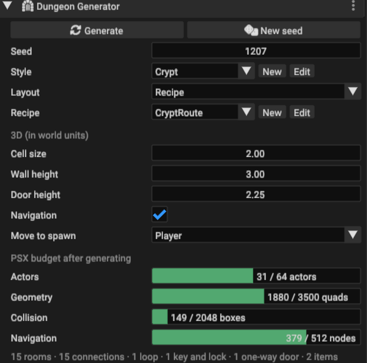

| Setting | Meaning | Default |
| --- | --- | ---: |
| Seed | Chooses the dungeon; same seed, same dungeon | random on creation |
| Grid size | Cells across and deep | 40 × 40 |
| Rooms | Rooms to place; a crowded grid fits fewer | 10 |
| Room size | Smallest and largest room side, in cells | 4 – 8 |
| Spacing | Empty cells kept between rooms; a corridor needs three to pass between two rooms | 3 |
| Corridor width | Corridor width in cells | 1 |
| Loops | Chance, in percent, that each extra connection becomes a loop; 0 gives a tree | 25 |

Rooms are placed at random positions that keep the spacing. Rooms whose centres see
each other across an empty circle are candidate connections; a spanning tree of them
connects every room, and each remaining candidate becomes a loop with the **Loops**
chance. Corridors are routed around other rooms, prefer straight runs and merge into
corridors that already exist. Spawn and goal are the two rooms the most
connections apart.

### 3D settings

| Setting | Meaning | Default |
| --- | --- | ---: |
| Cell size | World units per grid cell | 3 |
| Wall height | Height of walls, wall tops and the ceiling | 6 |
| Door height | Doorways are open below this height; a beam fills the rest | 3.6 |
| Navigation | Add navigation bake volumes over the floor | on |
| Player | The [player](#the-player): placed at the spawn room's centre after each generation, and the only actor that picks up keys | none |
| Character | **Fit sizes to it** sets cell size, wall and door heights from the Player's collider | — |
| Ceiling | Close the dungeon from above at the wall height | on |

The defaults fit the Third Person template's character (1.84 units tall) the way
third-person console games frame their heroes: corridors about 1.6 times its height,
doors twice, walls more than three times, so the camera behind the character sees
walls and never the sky. For another character choose it as **Player** and
press **Fit sizes to it**. Turn **Ceiling** off for top-down cameras: the ceiling
faces down, so it hides nothing from above, but it also stops anything flying out.
With a ceiling the dungeon's geometry casts no shadows: the map's light reaches floors
and walls, and the ceiling stays dark.

Walls are the solid cells around every floor, so the dungeon reads from above as well
as from inside. Floors and walls are one face per cell: every vertex then lies on the
grid, which avoids the one-pixel cracks the PSX shows where an edge ends in the middle
of another face, and gives baked lighting a vertex at every cell corner. Run
**Build > Build Lighting** after generating, or let Build and Play bake it. A map
without a directional light of its own gets one with the dungeon; point lights from a
style are local accents on top of it.

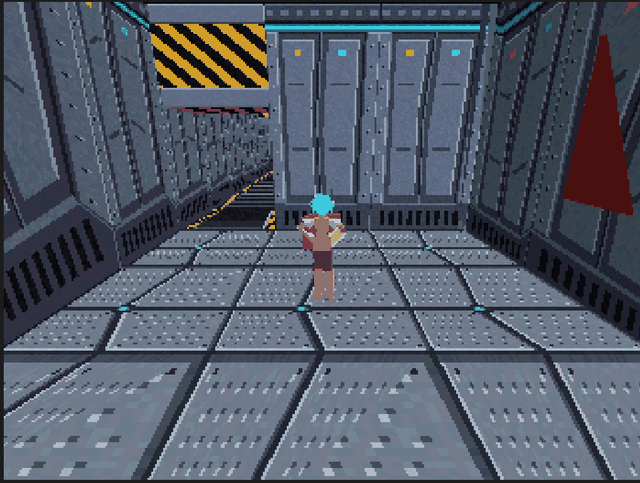

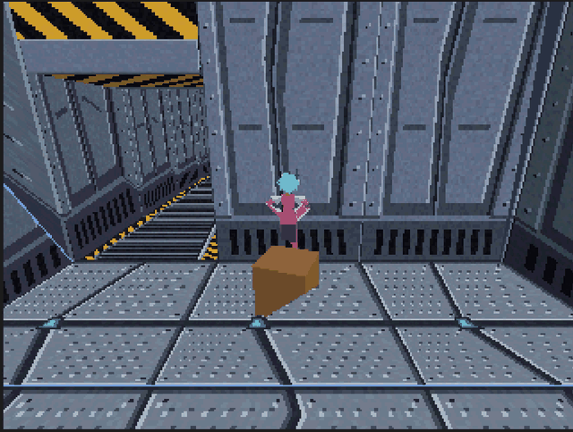

### Built-in textures

The built-in 3D look uses ten textures drawn for the console by
`tools/build_dungeon_textures.py`. The first generation imports those it uses into
`assets/Dungeons/Textures/`, always under the same asset identities, and refreshes them
in place when a newer Epok draws them differently.

- **Room floors, one per room:** steel plates with a lit hatch, a grid of teal panels,
  or a dark plate framed in amber around a grate.
- **Room walls, one per room:** panels with a cyan light strip, wide ribs under an amber
  band, or plain panels over pipes and a red warning band. Corridor walls use the first.
- **Corridors:** a grated floor with hazard rails, turned with the corridor.
- **Columns** along the walls of rooms, about one every two cells, with a lit capital.
- **Ceiling** panels and a hazard-striped **doorway beam**.

A room keeps its floor and walls throughout, so each room reads as a place of its own.

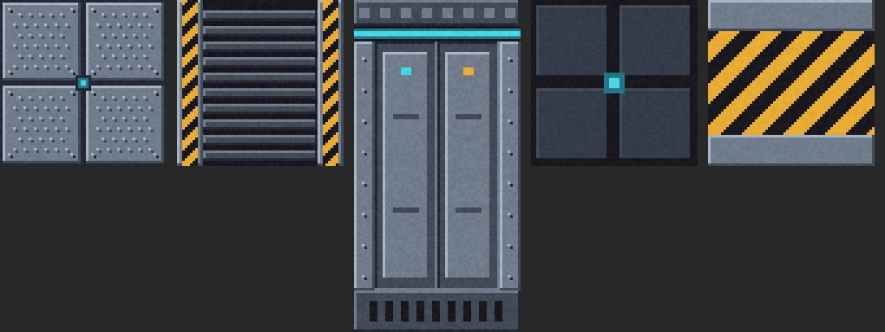

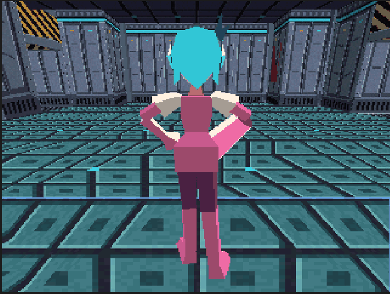

The console clamps texture coordinates instead of repeating them, so every Blockout
face maps its texture exactly once: a floor or ceiling cell, a wall side from just below
the floor to the ceiling, a doorway beam. Draw your own Blockout textures the same way;
a wall texture twice as tall as wide suits the default proportions.

### 2D settings

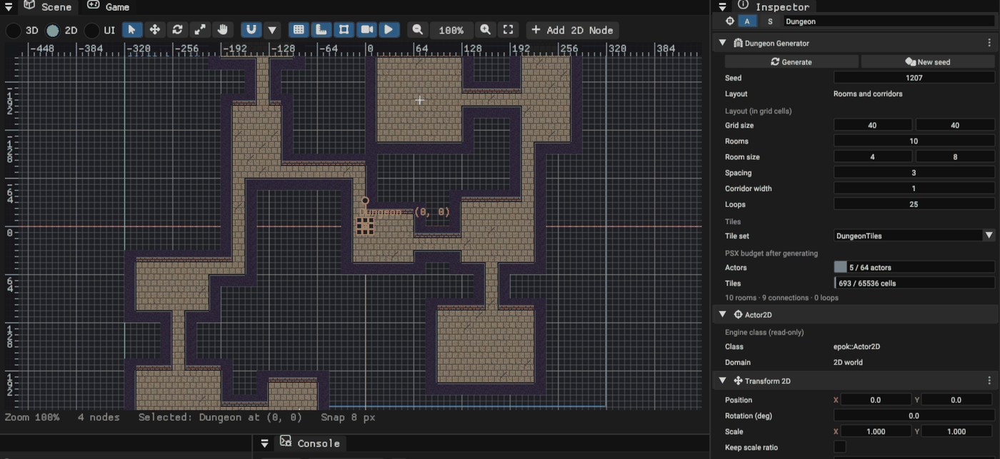

**Tile set** is the TileSet the style's terrains and tiles use when they name none.
*Built-in dungeon tiles* creates `assets/Dungeons/DungeonTiles.epokasset` on first use:
stone floor variants and solid walls with a brick face towards the room. Any TileSet
works when it has a terrain set holding the terrains the style paints (the built-in
look uses **Floor** and **Wall**); the TileSet's own terrain rules choose the tiles,
and its tile collision makes walls solid. One grid cell is one tile.

**Player** works as in 3D: the chosen 2D actor is placed on the spawn room's centre
(through any parent's position, rotation and scale) and is the only actor that picks
up keys.

### The player

The band's **Player** names the actor generation treats as the player: it is moved to
the spawn room's centre after each generation, and every generated key names it in its
`player` property, so only the player picks keys up; enemies, projectiles and other
moving colliders pass through them. Without a Player keys are picked up by anything
that enters them; the band then warns, and offers **Use Player** when the map has an
actor called Player.

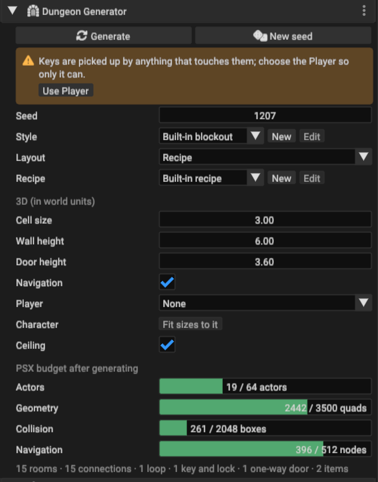

## Dungeon Recipes

A Dungeon Recipe is a list of steps that grows a dungeon's room graph, then lays it
out on the grid. Where *Rooms and corridors* places rooms at random, a recipe designs
the route: the player starts at the spawn, the goal waits at the end of the main path,
side branches hide treasure, a key opens a locked door further on, and one-way doors
offer shortcuts back.

- Set the generator's **Layout** to **Recipe**. Without a recipe asset it follows the
  built-in recipe; **New** creates a recipe asset from it (under
  `assets/Dungeons/Recipes/`) and opens it, **Edit** opens the chosen one. The Project
  browser's **Add > Dungeon Recipe** creates one too, and double-clicking a recipe
  opens it.
- The editor lists the **steps** on the left, in the order they run; the arrows move a
  step, **Add step** inserts one after the selection. The selected step's settings are
  below the list, each with a tooltip.
- The right side previews the **room graph** for one seed: one square per room slot,
  rooms coloured by path, links between them, the spawn (S) and goal (G), keys and
  items as dots, locked doors red with their key's number and one-way doors as blue
  arrows. Hover a room for its path, depth and contents. **Seed** and the dice button
  preview other seeds without touching any dungeon.
- Every valid edit is saved; with **Live preview** on, the map's dungeons that follow
  the recipe regenerate. A step with a problem (a path no earlier step grows, a range
  upside down) is amber, says why, and the recipe is not saved until it is fixed.

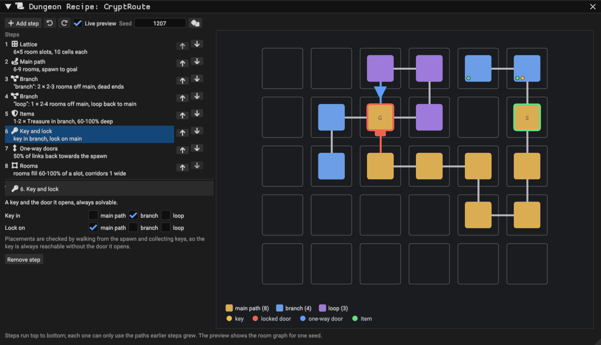

### Steps

| Step | What it does | Settings |
| --- | --- | --- |
| Lattice | The grid of room slots. Each slot holds at most one room; paths walk between neighbouring slots | Room slots (columns, rows), slot size in grid cells |
| Main path | The path from the spawn room to the goal room | Length in rooms |
| Branch | Paths that start next to rooms of other paths. With **Loops back to** empty they are dead ends; otherwise each ends next to a room of those paths and connects to it | Name, starts off, loops back to, count, length |
| Items | Named items in rooms of some paths, between two depths along each path (0% first room, 100% last), placed anywhere away from the doors, at the room's centre or against a wall | Name, paths, count, depth, in the room |
| Key and lock | A key in a room of some paths and the locked door it opens, on a link into a room of other paths | Key in, lock on |
| One-way doors | Links that lead back at least two rooms along the route open from the far side only | Chance |
| Caves | Rooms of some paths become organic caves that fill their slot | Paths, rock, smoothing |
| Rooms | How much of its slot each room fills, whether corners are cut, and the corridor width | Fill, cut corners, corridor width |

A recipe has one Lattice, one Main path and one Rooms step; Branch, Items, Key and
lock and Caves steps can repeat, and each step can only name paths that earlier steps
grow. The built-in recipe is a 6 × 5 lattice with a main path of 6–9 rooms, two dead-end
cave branches with treasure, a loop, a key on a branch for a lock on the main path,
one-way shortcuts and rooms with cut corners.

### Always solvable

Every key and lock placement is checked by walking from the spawn through open doors,
picking up keys and opening the doors they fit, until nothing new is reached: every
room must be reachable, and the key's own door must really keep its room out of reach
without the key, so a lock is never decorative. One-way doors are kept only when the
same walk still reaches every room. Several keys never deadlock, because each one is
checked with all the others in place.

When a step cannot be satisfied (a path longer than the lattice has room for, a branch
with nowhere to grow), the whole recipe runs again with fresh random numbers, up to 64
times; after that the generator says which step failed and suggests loosening it.

### Layout

Each room sits inside its slot, with empty cells around it. Corridors run straight
between neighbouring rooms, or jog once inside the gap between their slots, always one
cell clear of every other corridor and room. So the grid connects exactly the rooms the
graph links: a locked door cannot be walked around through a neighbouring corridor.
Unused slots are trimmed, keeping the dungeon centred on its generator.

Rooms are rectangles, rectangles with **cut corners** (one cell, or a three-cell
triangle in rooms at least eight cells across), or **caves**. A cave fills its whole
slot: rock is scattered more densely towards its edges (**Rock** sets how much), then
**Smoothing** passes of a cellular automaton turn it into rounded chambers. Every
shaped room keeps its centre, its doors and a way from each door to the centre, and
drops any pocket the centre cannot reach, so shapes never break the route or the
solvability check. Walls, wall tops, collision, navigation and 2D terrain follow the
shape like any other floor.

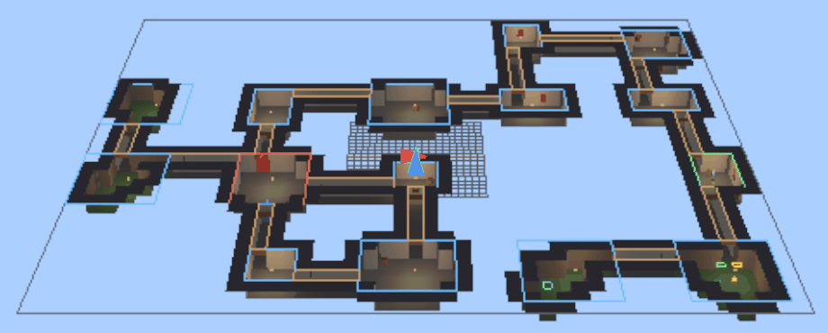

Recipe layouts add spots for the style (see [Spots](#spots)): **Key**, **Locked door**,
**One-way door** and **Item**. The built-in look places [working keys and
doors](#keys-and-doors-that-work-in-game) on the first two. It marks the others: in 3D
a green pedestal for items and a blue arrow on the floor pointing through each one-way
door (keys also float above a gold pedestal); in 2D marker tiles from the built-in
dungeon tiles (chevrons and a chest) on a decoration layer.

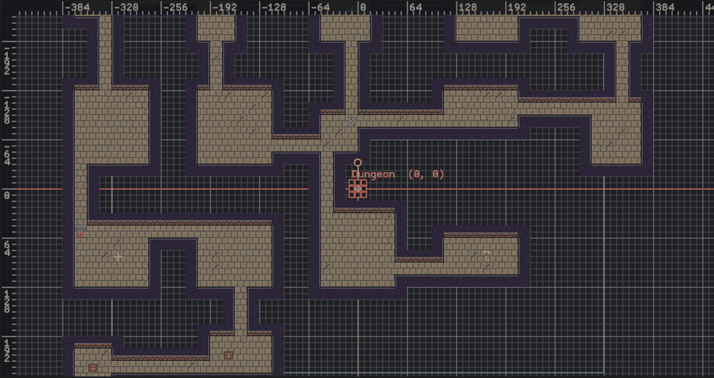

### Keys and doors that work in game

The style pieces **Key** and **Door** place ready-made keys and locked doors on Key and
Locked door spots, and the built-in style uses them:

| Piece | 3D | 2D | Behaviour |
| --- | --- | --- | --- |
| Key | A gold cube floating above the floor, with a trigger around it | An Area2D with the key sprite of the built-in tiles | Picked up the first time the [player](#the-player) enters its trigger; it deactivates (hides and stops colliding) |
| Door | A slab filling the doorway, as wide as a cell and as high as the door height, with a solid collider | A StaticBody2D with the gate sprite, turned towards its corridor | Blocks the doorway until the key with its lock number is picked up, then deactivates |

Both cost one actor each, take a colour (a tint in 2D) and the piece's offset, and carry
their lock number; each key names the generator's Player in its `player` property, and
each door names its key's actor in its `key` property. A key deactivates the first time
its player enters its trigger (anything, while `player` names no live actor); a door
deactivates once the actor its `key` names is no longer active. The first generation
that places one adds
`DungeonKey` and `DungeonDoor` to the project in C++ (`assets/scripts`) unless the
project already holds them in Blueprint or Lua, as the [Dungeon template](dungeon-template.md)
does for its flavor; the generator then uses those. They are ordinary project classes:
edit them to add a sound, an animation or a door that needs the player to come back
with the key. The generator never overwrites an edited copy; an unedited copy of an
earlier version (a key any collider picked up, or the C++ pair that shared a key ring)
is brought up to date the next time the dungeon is generated, and the report says so.

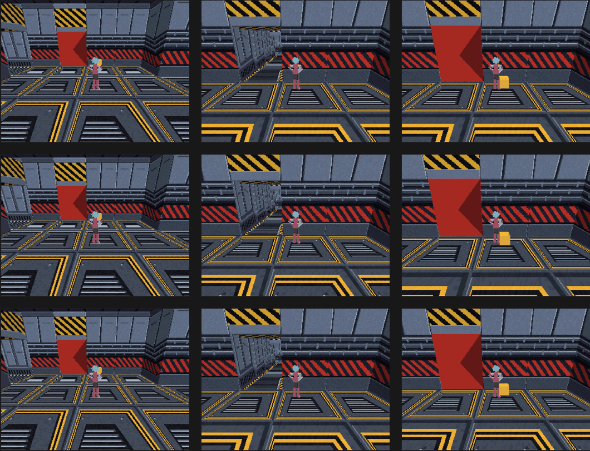

A key's trigger floats above the floor so the dungeon's own collision never touches it. Navigation is
baked with the doors closed.

Custom actors work too: an actor placed on a Key or Locked door spot with an **Actor**
piece gets the lock number in any editable number property named `lock`, on its class
or on one of its components:

```cpp
class EPOK_CLASS(Blueprintable, Domain=World3D, Id="your-class-uuid") MyGate : public epok::Actor3D {
public:
    EPOK_PROPERTY(EditAnywhere) uint32_t lock = 0;  // set by the Dungeon Generator
};
```

Item pieces can pick items by name with **Item name**, so a "Treasure" item can become a
chest and a "Potion" a bottle, and any piece can keep to the rooms of one path with
**Path**: mossy floors and rough walls in the cave branches, banners only along the main
path.

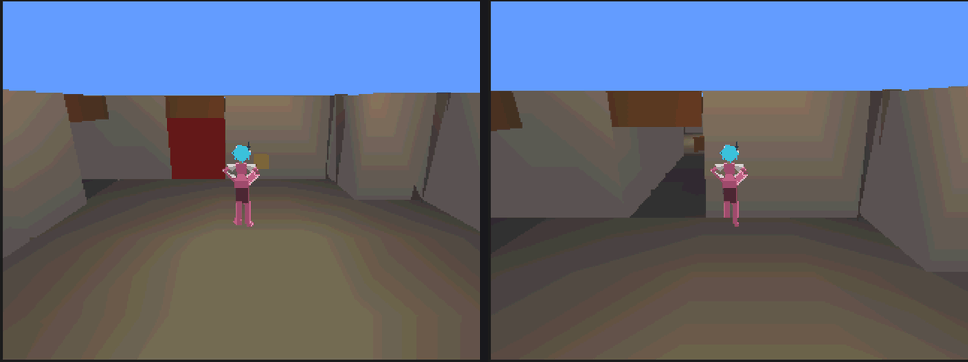

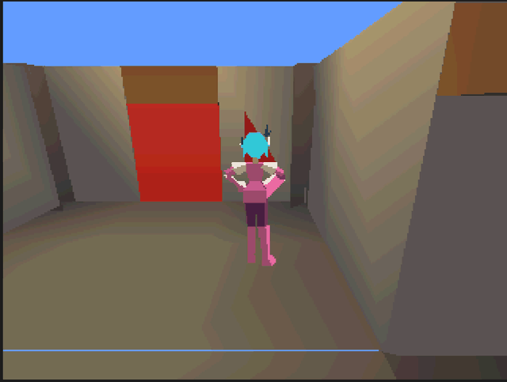

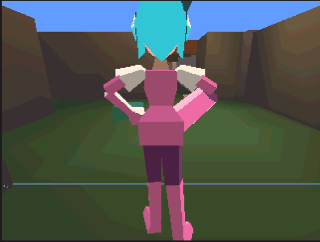

## Dungeon Styles

A Dungeon Style decides what every spot of a dungeon becomes. It is an asset, so one
style can dress many dungeons, and changing it restyles them all. Without a style a
generator uses the built-in look: blockout geometry in 3D, the built-in tiles in 2D.

- In the generator band, **Style** chooses the style. **New** creates a style asset
  holding the current look (under `assets/Dungeons/Styles/`) and opens it; **Edit**
  opens the chosen one. The Project browser's **Add > Dungeon Style (3D)** and
  **(2D)** create one too, and double-clicking a style opens it.
- The editor shows **spots** on the left and the **pieces** each spot becomes to their
  right. Pieces are tried from left to right, and each piece header shows its place in
  that order: drag a piece left or right to change its priority.
- **Add** (or right-click the canvas) adds a spot or a piece, with a search field.
  Dragging from a spot's dot to empty canvas adds a piece to that spot; dropping a
  piece on another spot moves it there. **Delete** removes the selection; **Ctrl+Z**
  and **Ctrl+Shift+Z** undo and redo; the wheel zooms and **F** or **Frame all** shows
  the whole style.
- Every finished edit is saved. With **Live preview** on, the dungeons of the open map
  that use the style regenerate at once, so the Scene view shows the result; those
  regenerations are one undo step in the map.
- A piece that cannot place anything (no mesh chosen, a 2D piece in a 3D style, a
  terrain on a wall spot) has an amber outline and says why. The details panel counts
  how many times the selected piece is placed in the open map.

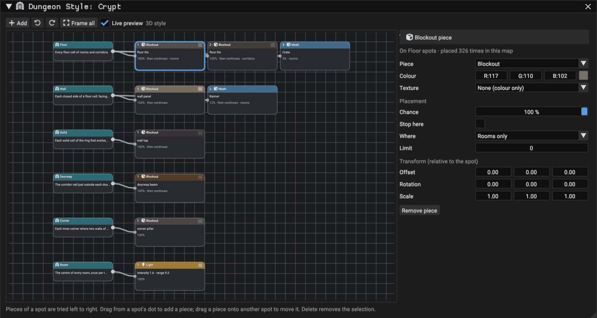

### Spots

| Spot | Where | Facing (+Z) |
| --- | --- | --- |
| Floor | Every floor cell of rooms and corridors | — |
| Wall | Each closed side of a floor cell | into the floor cell |
| Door | Each room side that opens onto a corridor | into the room |
| Doorway | The corridor cell just outside each door | towards the room |
| Solid | Each solid cell of the ring that encloses the floor | — |
| Ceiling | Each floor cell again, at the wall height (3D, with Ceiling on) | — |
| Column | Evenly spaced points along straight room walls, about one every two cells, at the start of their cell side | into the room |
| Corner | Each inner corner where two walls of a floor cell meet | away from the first wall |
| Room | The centre of every room, once per room | — |
| Key | Each key a recipe placed, at a room cell | — |
| Locked door | Each door that needs a key, on the guarded room's side | into the guarded room |
| One-way door | Each door passable only into its room | into the room |
| Item | Each item a recipe placed, at a room cell | — |
| Spawn, Goal | The centres of the spawn and goal rooms | — |

Spots sit at floor level, except Ceiling spots at the wall height. Wall, door, locked-door and one-way spots are on the cell
edge, corner spots on the corner point, the others at the cell centre. Key, locked-door,
one-way and item spots exist only in recipe layouts; a wide corridor's door has one
spot per cell.

### Pieces

| Piece | 3D / 2D | What it places | Cost |
| --- | --- | --- | --- |
| Blockout | 3D | The generator's own geometry for the spot: a floor tile, wall panel, wall top, ceiling tile, doorway beam, corner pillar or a column standing out of the wall (with collision), in a colour or texture (white keeps the texture's colours; a colour tints it) | Merged geometry |
| Mesh | 3D | An EditableMesh, merged into the dungeon's sections with its own materials | Merged geometry, no actor |
| Actor | both | An actor of any placeable class (C++, Blueprint or Lua), including Blueprint templates with child actors | One actor per placement |
| Light | 3D | A baked point light | One actor per placement |
| Terrain | 2D | The terrain a Floor or Solid cell is painted with | Tiles |
| Tile | 2D | One tile on a decoration layer above the floor, without collision | Tiles; one layer per TileSet |
| Key | both | A [working key](#keys-and-doors-that-work-in-game) on Key spots | One actor per placement |
| Door | both | A [working locked door](#keys-and-doors-that-work-in-game) on Locked door spots | One actor per placement |

Model meshes around the spot: floor level at 0, centred on the cell or the edge, and
facing +Z into the room for walls and doors. Generated collision always comes from the
layout; give props that must block the player an Actor piece with a collider instead.

### Placement

| Field | Meaning | Default |
| --- | --- | ---: |
| Chance | Percentage of eligible spots that get the piece | 100 |
| Stop here | When the piece places, pieces to its right are skipped at that spot. Off, it decorates and the next pieces are tried too | on |
| Where | Anywhere, rooms only or corridors only | Anywhere |
| Limit | Most placements in one dungeon, spread at random; 0 has no limit | 0 |
| Item name | Item spots only: just the items with this name (any case); empty takes every item | empty |
| Path | Recipe layouts: just the spots in rooms of this path (any case), such as `main` or a branch's name; corridors belong to no path | empty |
| Same for the whole room | Roll the chance once per room, so a room takes the piece on every spot or on none: texture variants and themed rooms. Corridor spots roll one by one | off |
| Offset, Rotation, Scale | Relative to the spot (2D: offset in pixels for actors) | 0, 0, 1 |

Texture variants are pieces that stop, roll once per room and sit left of the plain
piece: with a first variant at 33% and a second at 50%, a third of the rooms take
each. The built-in pieces do not stop: a piece added to their right decorates on top of them,
and one added to their left that stops replaces them. For example, a wall mesh with a
15% chance placed left of the blockout wall replaces 15% of the walls; a torch mesh
placed to its right adds torches to 15% of them. Each piece draws its own random
numbers from the seed, so editing one piece never reshuffles another.

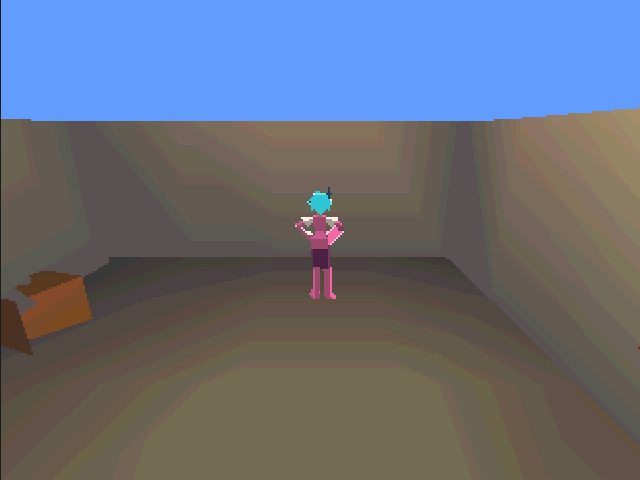

## Gameplay queries

Game code can ask about the generated dungeon on the console: which room the player is
in, which room comes next on the way to the goal, where the keys and locked doors are,
and where there is free floor for an enemy or a chest. Every generation bakes this with
the dungeon, and the map cooks it, so it costs a few constant tables and no actors.

Open **Gameplay queries** at the bottom of the generator band to see the rooms as game
code numbers them, with their path and their roles (spawn, goal, key, locked, item).
Pointing at a row picks that room out in the Scene view; its tooltip gives the level,
the rooms to the spawn and to the goal, its links and its free spots.

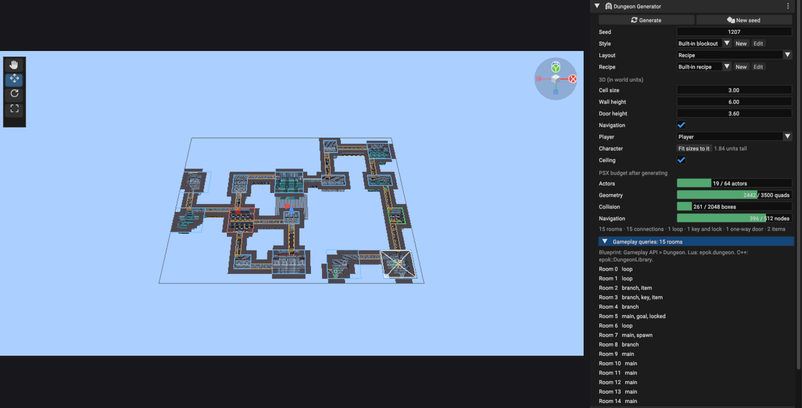

The queries are one library in every flavor: **Gameplay API > Dungeon** in the Blueprint
node menu, `epok.dungeon` in Lua and `epok::DungeonLibrary` in C++.

| Query | Returns |
| --- | --- |
| `room_count()` | How many rooms the dungeon has |
| `room_at(point)` | The room holding a world point (pixels in 2D), or -1 in a corridor |
| `room_of(actor)` | The room a 3D actor stands in, or -1; in 2D pass its position to `room_at` |
| `spawn_room()`, `goal_room()` | The spawn and goal rooms |
| `room(index)` | A record: `valid`, `index`, `center`, `minimum`, `maximum`, `level`, `path` (0 is the main path, then branches in recipe order), `depth` (rooms from the spawn), `steps_to_goal`, `neighbours`, `spots`, and `spawn`, `goal`, `key`, `item`, `locked` |
| `neighbour(room, index)` | The `index`-th room linked to `room`, or -1 |
| `next_room(from, to)` | The room after `from` on a shortest way to `to` |
| `distance(from, to)` | Rooms between two rooms, or -1 |
| `item_count()`, `item(index)` | Keys (`lock` above 0) and other items: `position`, `room`, `lock` |
| `lock_count()`, `lock(index)` | Locked doors: the doorway, the room it guards and the lock its key opens |
| `spot(room, index)` | Free floor away from the room's doors, keys and items, up to eight per room |
| `seed()`, `random(stream, index, below)` | The dungeon's seed, and a number below `below` that is the same for the same stream, index and seed on every run |

A beacon that floats in the next room on the way to the goal, in C++:

```cpp
const int32_t here = epok::DungeonLibrary::room_of(player);
const int32_t next = epok::DungeonLibrary::next_room(here, epok::DungeonLibrary::goal_room());
const auto target = epok::DungeonLibrary::room(next).center;
```

The same in Lua, then one enemy kind per room that never changes between runs:

```lua
local here = epok.dungeon.room_of(self.player)
local target = epok.dungeon.room(epok.dungeon.next_room(here, epok.dungeon.goal_room())).center
local kind = epok.dungeon.random(1, here, 3)
local where = epok.dungeon.spot(here, 0).position
```

Rooms are numbered as the generator built them and keep their numbers until the next
generation. The queries describe the first generated dungeon of the map, up to 64
rooms; without a dungeon every query answers -1, 0 or an invalid record. A dungeon
generated before the queries existed shows a warning with **Regenerate**.

## PSX budget

The band shows what the map will hold after generating, so a dungeon that would not
build is visible before it is generated.

| Meter | Limit | Notes |
| --- | ---: | --- |
| Actors | 64 per map | A 3D dungeon uses about eight to fifteen: geometry sections, collision, up to twelve navigation volumes, spawn, goal and a light when the map has none. Actor, Light, Key and Door pieces add one each. Every actor also costs runtime memory (several KB on the console), so prefer Mesh pieces for decoration. |
| Geometry | 3,500 quads per map | Counts the whole map. Surfaces are split every 4 units when compiled. |
| Collision | 2,048 boxes | One compound collider per dungeon. |
| Navigation | 512 nodes | Spacing grows with the floor area; very large floors skip navigation. |
| Tiles (2D) | 65,536 cells per layer | |

A 3D dungeon must stay within 254 units across (grid size × cell size), because mesh
vertices and collider boxes are stored within ±128 units of the generator. The
generator must be moved only, not rotated or scaled; the amber box offers a fix.

## Compound colliders

The generated collision is one `Collider3DComponent` carrying a list of boxes in the
actor's local space. The collider's own box encloses them and is only the broad phase:
movement, raycasts, overlaps, ground probes, triggers and the navigation bake all test
the individual boxes. An actor with a compound collider, and its parents, must not be
rotated or scaled.

## Automation

- MCP `dungeon_generate` regenerates a generator named by its actor, or creates one
  with `create: "3d"` or `"2d"`. `seed` and `settings` change it first (`style` takes a
  Dungeon Style asset id; `source: "Recipe"` with `recipe`, a Dungeon Recipe asset id or
  none for the built-in recipe, switches to a recipe layout); `new_style` creates a style
  from the current look and assigns it, `new_recipe` a recipe from the current one;
  `clear` removes the generated content. The change is one entry in `scene_history`.
  `asset_document` reads and replaces a style's or a recipe's document, refusing
  invalid ones with the step at fault.
- `--generate-dungeon <actor>` regenerates headlessly and saves the map;
  `--generate-dungeon 3d` or `2d` adds a new generator. `--dungeon-seed N` and
  `--dungeon-settings '<json>'` (for example `{"rooms":{"rooms":14},"spawn_actor":"Player"}`)
  apply before generating; `--dungeon-new-style <name>` creates a style from the current
  look and assigns it, `--dungeon-new-recipe <name>` a recipe (and switches the layout
  to it).

## Determinism

Generation uses integers and the dungeon random stream. `runtime/dungeon_random.hpp`
is the C++ twin of the editor's stream; both are tested against the same values, so a
seed chosen in the editor can be reproduced on the console. Generated asset and actor
identities derive from the generator and the role of each piece, so regenerating
rewrites the same files and keeps references to the generated actors valid.

## Verification

- `cargo test dungeon` covers layouts (reachability, spacing, loops, validation),
  recipes (reproducible graphs, solvability with several keys, locks that cannot be
  walked around on the grid, loops, one-way doors, readable errors), the bake into real
  projects (cook, navigation bake, regeneration, clearing, spawn placement, markers,
  face winding) and the random stream's golden values.
- `python tests/runtime/verify_spatial.py compound_collision dungeon_random` runs the
  compound collider and random stream host tests.
- Screenshot a generated dungeon with
  `--screenshot <png> --frame-dungeon` (add `--screenshot-2d` for a 2D generator), the
  recipe editor with `--open-dungeon-recipe <step>`, and gameplay with
  `--screenshot-game --screenshot-input "500:16,2600:0"`.
