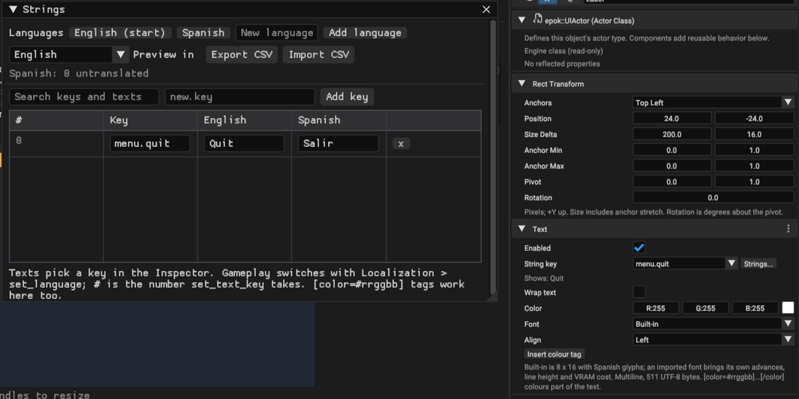

# HUD and 2D entities

Create Canvas, Panel, Image, Text, Button, Check Box, Slider or Progress Bar through GameObject > UI or Hierarchy's context menu. Epok adds a Canvas automatically when necessary. These are ordinary scene entities with hierarchy, scripts, renaming, duplication and persistence.

Panel combines RectTransform and Image. Text and ProgressBar are independent graphics components. Add Component can add Canvas to an empty root entity, RectTransform to a UI child, and graphics to an entity with RectTransform.

## Layout

Scene's **UI** mode opens Canvas editing. It is one of the three authoring modes — **3D**, **2D** and **UI** — selected above the viewport; see [View modes](editor.md#view-modes). Select an element to drag it, or resize it from its lower-right corner. Inspector exposes Anchor Min/Max, Pivot, Position and Size Delta with anchor presets.

The Hierarchy in UI mode lists this map's canvases and rect elements together with its UI actors. Domain-neutral Empty objects, scripts, audio and resource holders remain visible and editable here; this keeps the authored side of a procedural HUD available beside its preview. Runtime-only elements created by a script are not added to the authored Hierarchy. An element of another spatial domain that still has UI children appears greyed out so the branch keeps its shape; those lines are labels only.

Anchors and pivots range from 0 to 1. Positions use reference pixels with +Y pointing up. Size Delta adds to the space between anchors so elements can stretch with their parent. Reparenting with world preservation keeps the visible rectangle.

The Canvas mode is **Screen Space - Overlay** at the resolution selected in [Project Settings](settings.md), 640 x 480 by default. Positions and sizes use native pixels; anchors follow the canvas size. PSX draws it after the 3D world. The 3D Transform does not change RectTransform layout. Draw order is parents before children and siblings in creation order.

Graphics clip to the Canvas, not their parent's rectangle. Text is limited to its own width. Disabling Canvas hides its subtree; graphics also have Enabled flags.

## Automatic layout

**Horizontal Box**, **Vertical Box**, **Grid**, **Margin** and **Center** are rects carrying a **Layout Container**. A container measures its children and assigns their rectangles, so a list of items needs no hand-placed coordinates. A child of a container ignores its own anchors and Position; everything outside a container resolves from anchors exactly as before, so existing maps are unaffected.

Every child of a container is measured by one rule, per axis: the larger of what its content needs, its own Size Delta, and its Layout Element Minimum. Content means the space unwrapped text occupies for a label, and — for a box that is itself a container — the size its own children add up to. So a nested Vertical Box whose items are 60 wide but whose Size Delta is 150 asks for 150; set that Size Delta to zero and it follows its content instead. Size Delta is a floor, never a ceiling.

The container then hands each child a cell: a Horizontal Box divides its width left to right, a Vertical Box its height top to bottom, and a Grid fills `Columns` cells per row starting at the top-left. Margin and Center give their children the rectangle shrunk by the four padding values, in left, top, right, bottom order — the order Image's nine-slice borders use.

A container measures and places exactly the children it draws. Clearing an element's Active flag takes it out of the list entirely: the items after it move up and the box measures smaller, rather than a hole being left where it used to be.

**Layout Element** decides what the child does inside that cell, per axis. **Fill** takes the whole cell; **Expand** claims a share of the space left over after every minimum is satisfied, divided in proportion to **Stretch**; **Shrink Center** and **Shrink End** keep the measured size and move it within the cell. With no Layout Element a child fills its cell without expanding, which packs a box tightly against its first edge.

Layout runs in the same fixed-point pass the console uses, so the editor viewport, the native preview and the PSX build agree on every rectangle. Each laid-out rect still costs one entry of the scene's `hud_budget.layouts`.

## Panel styling

Image's **Nine-slice borders** hold back the left, top, right and bottom strips of the source region so a frame keeps its corners at any size; all four at zero stretches the whole region as before. **Tiling** decides how the remaining area is filled: **Tile** repeats the region at its own texel size starting from the rect's bottom-left and clips the last column and row, and **Tile Fit** rounds the count on each axis to the nearest whole number, at least one, and scales the tiles so they fill exactly. With borders set, only the centre piece tiles. Every tile is one more textured quad and counts against `hud_budget.rectangles`, so a large panel over a small source is expensive; the editor refuses a scene whose tiles overrun that budget.

## Focus and D-pad navigation

**Button** is a recipe — a rect with an Image, an unwrapped Text and a **Focusable** — not a new component type. Focusable names the element reached by each D-pad direction, a tab **Order**, and a **Highlight** colour. Focus itself is one index on the Canvas, its **Initial focus**, which the runtime then moves: on a direction's press edge it follows that link if the target is alive, active and focusable, and otherwise stays put. Nothing searches, so a menu of any size costs the same. While an element holds focus its Image and Progress Bar colours are multiplied by its Highlight, which lights a button up without emitting a single extra primitive. Neighbours are stored as actor indices, so reordering actors means revisiting the links; the inspector picks them by name, and the viewport draws each one as a line from the selected element to its target.

### Pressing, check boxes and sliders

**Cross** presses the focused element and **Circle** cancels on it. Neither moves the focus; each leaves an event on the element that gameplay collects once, through `FocusableComponent::take_pressed()`, `take_changed()` and `take_cancelled()` (Blueprint and Lua get the same calls). An event nobody reads is simply overwritten by the next one, so a menu that only cares about Cross ignores the rest at no cost.

A **Check Box** is the same Focusable with **Kind** set to **Toggle**: Cross flips its **Checked** state and raises a changed event, and the box itself is drawn at the right edge of the rect, three fills — frame, well and, when checked, a mark — beside the element's own Text. `is_checked()` and `set_checked()` read and set it from gameplay.

A **Slider** is a Progress Bar with a **Slider step** above zero on a focusable element. While it holds focus, Left and Right move its value by that step, clamped to 0..1, and raise a changed event instead of moving the focus; Up and Down still follow the neighbour links. It draws a handle at the end of its fill — one more rectangle — and gameplay reads the value with `value()` as for any Progress Bar.

The Button, Check Box and Slider recipes start with an amber **Highlight**, so the focused element shows without any setup; a check box's frame and a slider's handle carry that tint too. Set it back to white for a widget that should not change when focused.

## Colour tags

A Text may recolour part of itself: `[color=#ff4040]LOW[/color] HEALTH` draws `LOW` in red and the rest in the Text's colour. Tags take no room and cost nothing at runtime beyond the glyphs they colour; a malformed tag is drawn as plain text. They work in the Strings table too, and the Inspector's **Insert colour tag** button appends an empty pair to fill in.

## Localization

**Window > Strings (Localization)** opens the project's string table — created on first use as `assets/Localization/Strings.epokasset` — as a grid of keys and languages. The first language is the one the game starts in; a language's menu makes another the start language or removes it. Untranslated entries are counted per language and highlighted in the grid; they fall back to the first language at runtime. **Preview in** shows the open map in any language, and **Export CSV** / **Import CSV** round-trip `assets/Localization/strings.csv` (a header row `key,<language>,...` and one row per key) for spreadsheets or translators.



A Text picks a **String key** in the Inspector, under its text; the field then shows what the key reads in the preview language. Gameplay switches language with `LocalizationLibrary::set_language(index)` (Blueprint and Lua: **Localization > set_language**), which rewrites every keyed text of the scene at once and is remembered across scene changes; `language()`, `language_count()` and `key_count()` describe the table. A text created or changed at runtime uses `TextComponent::set_text_key(index)`, the **#** column of the table.

Only scenes with keyed texts carry the table. It is cooked into that scene's bank, every language in it, so each language adds its strings' bytes to the bank's RAM. Tables are limited to 4096 keys, 16 languages and 511 bytes per entry, and a keyed text budgets glyphs for its longest translation. Characters follow the Text's font: the built-in font covers ASCII and the Spanish set, so other scripts need an imported font with those glyphs.

## Rotation

A Rect Transform's **Rotation** turns the element about its pivot, in degrees, counter-clockwise. Layout is untouched: the rect the container or the anchors decided stays axis-aligned, and the rotation rides alongside it, so a child of a rotated panel turns with the panel without its own rect changing. An element with zero rotation emits exactly the primitives it always did, packet for packet. A rotated one cannot: the console rasterizes rectangles and sprites axis-aligned, so its fills, images and glyphs become polygons and come out of a separate pool sized by `hud_budget.rotated` (128 by default), counted in `hud_stats.rotated` rather than against rectangles and glyphs. A rotated text element therefore costs about twice the packet space of the same text upright. In the viewport the selection outline and its eight handles follow the turned corners, and a ring above the top edge rotates the element; hold Shift while dragging it to snap to fifteen degrees.

## Fonts

A Text draws with the built-in font unless it names one of the project's imported Font assets. The built-in font is the attributed mig68000 8 × 16 bitmap with derived Spanish glyphs, `áéíóúüñÁÉÍÓÚÜÑ¿¡`: one fixed cell per character, eight pixels of advance and sixteen of line height. It is resident for the whole run, costs nothing to use and is what every existing scene keeps.

An authored font is a TrueType or OpenType file imported as a Font asset, baked at its chosen pixel height over its chosen character ranges. Its glyphs carry their own width, advance and offsets, so text is proportionally spaced and the line height comes from the face rather than from a cell. Pick it in the Text section's **Font** combo; **Built-in** returns to the bitmap. The editor refuses a scene whose label contains a character the chosen font has no glyph for, and at runtime a character that survives anyway draws the font's question mark, or advances by a space when the font has neither.

Authored fonts cost VRAM. Each is a 4bpp atlas, at most 256 × 256 pixels, plus a sixteen-entry palette. The texture packer places both (see [PSX texture cooking](texture-cooking.md)), so fonts and textures share the same VRAM, and a project that does not fit is rejected at export rather than overlapped. Fonts are global, one set for every scene bank, so they are placed first and from the font set alone: every bank packs its textures around the same font placement. Memory shows each font beside the textures as an atlas and a palette rectangle. The import dialog reports the same figure before you commit, so a range or pixel-height change can be judged there.

**Align** places each measured line inside the rect: **Left**, **Center** or **Right**. Alignment measures a line before placing its first glyph, which bounds a centred or right-aligned block at thirty-two rows; left-aligned text is unbounded. The glyph budget is unchanged either way — one glyph is one primitive, and one text element is still one texture-page primitive, whichever font it uses.

## UI actors

A map can also hold **UI actors**: classes deriving from `epok::UIActor`, whose root
component is a `epok::RectTransformComponent` and which follow the same anchored
layout rules as the entities above. They are authored from the Actor submenu, appear
in the UI mode of the Hierarchy, and may carry any component whose owners include the
UI domain — `epok::AudioComponent` among them, which is how a menu sound and a world
sound end up being the same kind of thing. See
[Actors and components](actors.md) for the class model and its current limits.

Canvas entities and UI actors coexist in one map. Nothing about the entities above
changes, and the HUD budget covers both.

## Native component access

```cpp
if (auto* bar = entity().get<epok::ProgressBar>())
    bar->value = 0.5;
if (auto* label = epok::find_entity("Score"))
    if (auto* text = label->get<epok::Text>())
        text->set_text("SCORE 00100");
```

Entities and components can also be created in C++:

```cpp
auto* canvas = epok::create_entity("HUD");
if (!canvas) return;
canvas->add<epok::Canvas>();

auto* label = epok::create_entity("Score", canvas);
if (!label) return;
auto& rect = label->add<epok::RectTransform>();
rect.anchor_min[0] = rect.anchor_max[0] = rect.pivot[0] = 0.0;
rect.anchor_min[1] = rect.anchor_max[1] = rect.pivot[1] = 1.0;
rect.position[0] = 12.0;
rect.position[1] = -12.0;
rect.size[0] = 160.0;
rect.size[1] = 16.0;
label->add<epok::Text>().set_text("SCORE 00000");
```

Add RectTransform before graphics, beneath a Canvas or another RectTransform. Use `EntityHandle` for references that must detect destruction or scene changes. `destroy_entity` releases a runtime slot for reuse; creation returns null when all 32 additional slots are occupied. Play changes are not saved into authored scene files.

## Current limits

Image supports an imported Texture UUID and an atlas rectangle in pixels. Zero width/height selects the remaining texture from the specified origin. Transparent texels reveal previously drawn content. Optional left/top/right/bottom nine-slice borders preserve corner sizes while stretching the center; small destination rectangles shrink borders proportionally.

Text accepts up to 511 UTF-8 bytes, explicit newlines and optional character wrapping, with the built-in bitmap or an imported font (see **Fonts** above). Wrapping breaks before the first glyph whose advance would cross the right edge; without wrapping that glyph is dropped rather than moved. Text clips to its own rect and the screen. ProgressBar retains its fill/background colors.

The scene's `hud_budget` configures layouts, rectangles, text components and glyphs. Defaults are 128 / 256 / 64 / 1024; maximums are 128 / 512 / 64 / 2048. Edit them in **Map Settings**, opened by clicking the map root at the top of the Hierarchy; Project Settings > Rendering keeps the heading and a button that opens it. Nine-slice images budget nine rectangles. The editor rejects authored over-budget scenes; dynamic excess is omitted and counted in `hud_stats.dropped`. Standalone builds reserve the maximum requested by their registered scenes.

Scroll containers, tab bars and shared themes are not part of this profile yet; a long list is a Vertical Box whose position the game moves, and a tab bar a row of Buttons that activate one panel each.

`utility.hpp` supplies generic `Focus`, `EventQueue`, and `layout_list` APIs. Focus skips inactive/destroyed handles, supports forward/reverse navigation, and emits activation/cancel events. These are primitives for the game's UI logic. Parent masks and world-space Canvas remain outside this profile; so does scaling a font at runtime, which is an import-time choice.

The editor and PSX use the same generated bitmap data and the same cooked font atlases. Font and derived glyph attribution is preserved in [third-party notices](../THIRD_PARTY_NOTICES.md).
