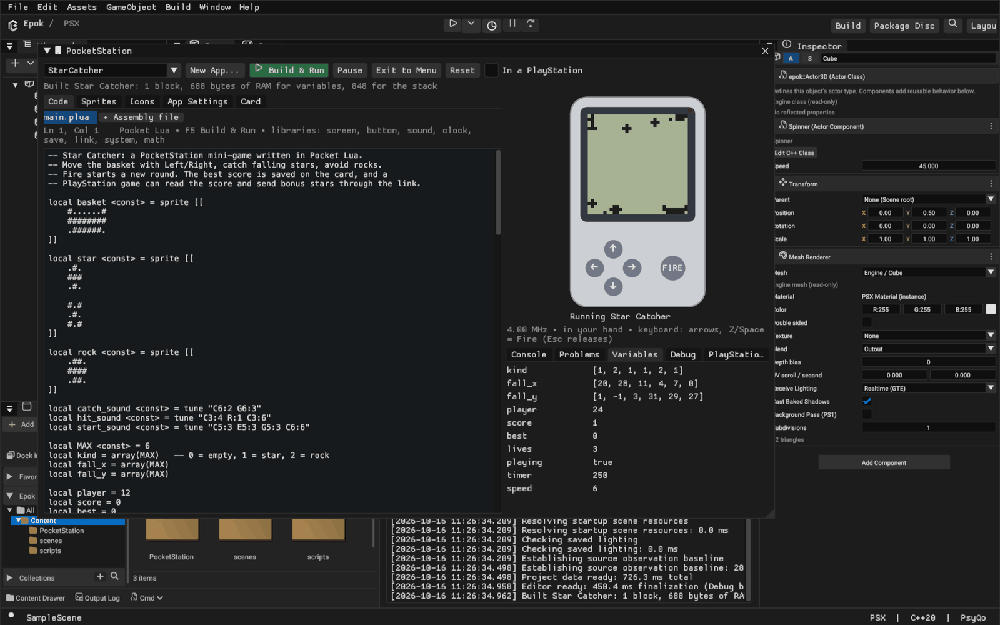
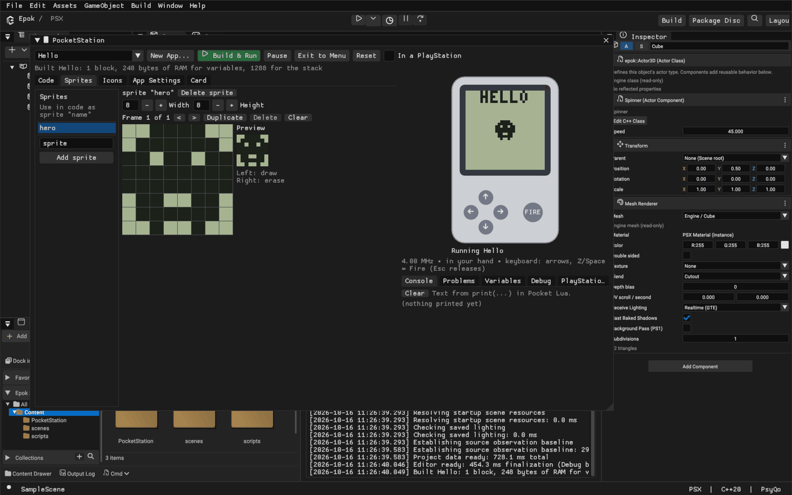
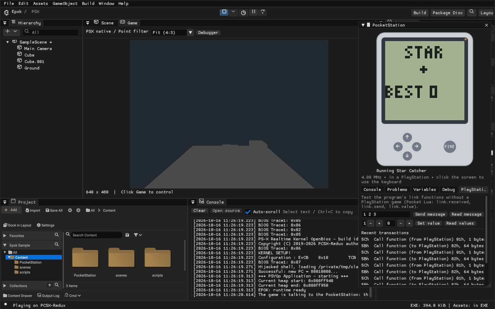

# PocketStation

The PocketStation is Sony's memory card with a 32 × 32 monochrome screen, five
buttons, a speaker, a real-time clock and its own ARM CPU. A PlayStation game can
copy a small program onto it, start it, and exchange data with it while it sits in
a memory card slot; the player can then take it away and play on the go.

Epok covers the whole loop:

* **PocketStation apps** are project assets written in **Pocket Lua** (Lua compiled
  to ARM code by Epok) or in **ARM/Thumb assembly**, with sprites and icons drawn in
  the editor.
* The **PocketStation window** edits, builds and runs them on an embedded
  PocketStation emulator, with a debugger, live variables and a link tester.
* **PlayStation games** install, start and talk to those apps through
  `epok::pocketstation` (C++), Blueprint nodes and Lua.
* **Play** connects the game running in PCSX-Redux to the editor's emulated
  PocketStation in memory card slot 1, so both sides are tested together.



## Your first app

1. In **Project**, choose **Add > PocketStation App...** (or **Window >
   PocketStation > New App...**).
2. Pick **Star Catcher** for a complete mini-game, **Empty Pocket Lua app** for a
   starting point, or **Assembly** for a bare Thumb program.
3. Press **Build & Run** (F5). The app is compiled, copied to the emulated
   PocketStation's card and started.
4. Click the screen and use the **arrow keys** and **Z / Space / Enter** (Fire), or
   click the buttons on the device. **Esc** releases the keyboard.

Every save is automatic. **Exit to Menu** returns to the PocketStation's clock and
program menu, where Left/Right choose a program and Fire starts it, as on the
device. **Reset** presses the reset button; the card keeps its files.

## Which language

| | Pocket Lua | Assembly |
| --- | --- | --- |
| For | Games and utilities | Timing-critical routines, full control |
| Toolchain | Built into Epok | Built into Epok |
| Errors | Line-accurate, with suggestions | Line-accurate |
| Debugger | Source line, live variables | Registers, source line |
| Mixing | Calls assembly functions directly | Can be the whole program |

**Pocket Lua is the recommended language.** The PocketStation has 2 KiB of RAM
(1.5 KiB for the program) and no floating point, so Pocket Lua keeps Lua's syntax
and drops what cannot fit: numbers are 32-bit integers, tables are fixed, and
types are checked when compiling. Epok compiles it straight to compact Thumb code,
so no external compiler has to be installed and errors point at your line.

Assembly is assembled by Epok too. Write a whole program in it, or add assembly
files to a Pocket Lua app for routines that must be as fast as possible.

C is not offered: it would need a separately installed ARM cross-compiler and a C
runtime that leaves little of the 1.5 KiB of RAM, and its errors and debugging
would not be connected to the editor.

## Pocket Lua

A program declares its variables, sprites, tunes and tables at the top of the
file, and functions. The runtime calls `init()` once, then `update()` and `draw()`
30 times per second; the screen is shown after `draw()`.

```lua
local hero <const> = sprite [[
    ..##..
    .####.
    ##..##
]]
local x = 12
local beep <const> = tune "C5:4 E5:4 G5:8"

function update()
    if button.down(button.LEFT) then x = x - 1 end
    if button.down(button.RIGHT) then x = x + 1 end
    if button.pressed(button.FIRE) then sound.play(beep) end
end

function draw()
    screen.clear()
    screen.sprite(hero, x, 20)
    screen.number(x, 0, 0)
end
```

### Values

| Type | Created with | Lives in |
| --- | --- | --- |
| number | `42`, `0x2A`, `0b101` (32-bit whole numbers) | RAM |
| boolean | `true`, `false`, comparisons | RAM |
| sprite | `sprite [[ rows ]]` or `sprite "name"` | flash |
| tune | `tune "C5:4 R:2 G5:8"` | flash |
| table | `{1, 2, 3}` — read only | flash |
| array | `array(8)` or `array{1, 2, 3}` — changeable | RAM |
| string | `"HELLO"` — for `screen.text` and `print` | flash |

* Top-level `local` names are the program's variables. `local NAME <const> = 5` is a
  compile-time constant that uses no RAM.
* Sprites, tunes, tables and arrays are created at the top of the file. Indexing
  starts at 1, as in Lua; `#t` is the length. An index outside the array stops the
  program with an error showing its line.
* Sprite rows use `#` for black and `.` for white; leading spaces are ignored. A
  blank line starts the next frame. `sprite "hero"` uses the sprite drawn in the
  **Sprites** tab.
* Tunes are notes `C D E F G A B` with `#` or `b`, an octave and a length in frames
  (1/30 s): `"C#5:6"`. `R:4` is a rest.

### Operators and control flow

`+ - *`, `//` (floor division) and `%` (floor remainder) behave as in Lua; `/` is
rejected because it would produce a fraction. Bitwise `& | ~ << >>` are available
(`>>` is a logical shift). Conditions must be booleans: write `if lives > 0 then`,
not `if lives then`. `and`, `or`, `not`, `if/elseif/else`, `while`, `repeat/until`,
numeric `for i = a, b, step` and `break` work as in Lua.

Functions take up to four parameters, numbers unless annotated
(`function draw_at(s: sprite, x, y)`); the return type comes from the `return`
statements or an annotation (`function score(): int`).

### Libraries

| Library | Functions |
| --- | --- |
| `screen` | `clear()`, `fill()`, `invert()`, `pixel(x, y [, on])`, `get(x, y)`, `line(x0, y0, x1, y1)`, `rect(x, y, w, h)`, `box(x, y, w, h)`, `sprite(s, x, y [, frame])`, `erase(s, x, y [, frame])`, `text(str, x, y)`, `number(n, x, y)`; `WIDTH`, `HEIGHT` |
| `button` | `down(b)`, `pressed(b)`, `released(b)` with `FIRE`, `LEFT`, `RIGHT`, `UP`, `DOWN`, `ANY` |
| `sound` | `tone(hz, frames)`, `play(tune)`, `stop()`, `playing()` |
| `clock` | `year()`, `month()`, `day()`, `weekday()`, `hour()`, `minute()`, `second()` |
| `save` | `get(slot)`, `set(slot, value)`, `write()` — 32 numbers kept in the program's own flash sector |
| `link` | `connected()`, `received()`, `byte(i)`, `clear()`, `put(i, v)`, `send(n)`, `busy()`, `value(i)`, `set_value(i, v)` |
| `system` | `exit()`, `frame()`, `docked()`, `speed(1-8)`, `fps(n)`, `param()` |
| `math` | `random(n)` (1 to n), `abs`, `min`, `max`, `clamp` |
| `print(v)` | Writes to the **Console** panel (ignored on a real PocketStation) |

Runtime errors (index out of range, division by zero, too many nested calls) stop
the program and show `E` and the line on the PocketStation's screen; the editor
shows the message and a **Show line** button.

### Memory

**App Settings** shows the last build's flash blocks and RAM. The runtime uses 240
bytes, the link adds 208 bytes when `link` is used and save data adds 128 bytes
when `save` is used; each variable takes 4 bytes and each array `4 × (n + 1)`. What
remains is the stack, which needs at least 128 bytes.

## Assembly

Assembly programs start at the label `main` in user mode with the start parameter
in r0; mark Thumb entry points with `.thumb_func`. The assembler accepts the usual
ARM syntax: `;`, `@` or `//` comments, `label:` and numeric local labels (`1:` with
`1b`/`1f`), `ldr rX, =value` literal pools (flushed by `.pool`), `.word`, `.hword`,
`.byte`, `.ascii`, `.space`, `.align`, `.equ` and `.include`. Thumb conditional
branches that are too far are rewritten automatically.

Inside a Pocket Lua app, an assembly file's `.global` Thumb functions are called
like Pocket Lua functions: up to four numbers in r0-r3, the result in r0; keep r4-r7.

```asm
    .thumb
    .global triple
    .thumb_func
triple:
    mov r1, r0
    add r0, r0, r1
    add r0, r0, r1
    bx lr
```

A pure assembly program provides its PlayStation link functions as labels
`link_80`, `link_81`, ... with `.equ link_80_parameters, n`.

The kernel's system calls are available with `swi`; the most useful are `01h`
SetCallbacks (IRQ/FIQ handlers), `03h` FlashWriteVirtual, `04h` SetCpuSpeed,
`08h`/`09h` PrepareExecute/DoExecute (start another program or return to the menu),
`0Dh`/`0Eh` date and time, `11h` SetComOnOff (let the PlayStation talk to the
program) and `16h` GetDirIndex. The screen is 32 words at 0D000100h, one row each
with bit 0 on the left; the buttons are bits 0-4 of 0A000004h.

The emulator lists accesses that work differently on a real PocketStation in the
**Debug** panel, for example 8-bit reads from flash, which return garbage on the
device.

## The PocketStation window

| Tab or panel | What it does |
| --- | --- |
| Code | Integrated [Monaco editor](code-editor.md) with tabs, source tree and PocketLua completion; **New > Pocket Assembly** adds routines callable from Pocket Lua |
| Sprites | Pixel editor with frames and an animated preview; left button draws, right button erases |
| Icons | The animated 32 × 32 menu icon and the 16 × 16, 16-colour icon of the PlayStation memory card screen |
| App Settings | Title, memory card file name, flash/RAM use, export to `.mcs` or raw `.bin` for real hardware |
| Card | The emulated PocketStation's card (`UserSettings/PocketStation.mcd`): start, export or delete files, format |
| Console | `print` output |
| Problems | Build errors and warnings; click one to show its line |
| Variables | Live values of the program's variables and arrays |
| Debug | Pause, step, registers, the current source line and hardware differences |
| PlayStation Link | Sends messages and reads or sets the shared values like a PlayStation game would |

**In a PlayStation** inserts the emulated PocketStation into a PlayStation slot:
the PlayStation can then talk to the running program and the screen turns around,
as on the device.

The memory card file name identifies the program on a card; Sony's convention
puts `P` as the seventh character of PocketStation programs (for example
`BEEPOKP12345GAME`). Two apps in one project need different names.



## PlayStation games

Every PocketStation app in the project is embedded in the game (about 8 KiB per
block), so the game can copy it to a PocketStation and start it. Each call below is
one blocking operation on the memory card bus, including a roughly 16 ms
deselected recovery interval before each command; call
them from gameplay code, not from interrupts. Port 0 is the first memory card
slot; port 1 selects the second slot on hardware. Physical transfers reserve
PSYQo's `SIO0Bus`, so controller polling cannot change the selected port or consume
acknowledgements midway through a command. If an asynchronous memory card
operation already owns that bus, the request returns `PocketError::Busy` without
touching it. Receive waits are bounded and release ownership on failure.
The polled SIO path acknowledges only I_STAT's controller bit, before resetting
the SIO interrupt source. It preserves DMA, music-timer and VBlank edges that
arrive during a card transaction.

For frame-based code, `PocketRequest` in `pocketstation_async.hpp` queues one
command. Call `poll(dt_us)` each tick until it is ready, then inspect `error()`,
`received()` and `reply()`. On hardware it reserves SIO0 with the card deselected
for at least 270 HSyncs (about 17 ms) before sending the command. Rendering and
music continue during that interval; simulation catch-up ticks cannot shorten
it. An unanswered address is retried at most three times with a fresh recovery
interval. Commands that have already been sent are not automatically repeated.
The bus reservation is released on completion or destruction and transferred
when the request is moved. A pending request cannot be copied.

### Blueprints and Lua

* **PocketStation / Start app** (`epok.start_pocketstation_app(app, port)`) installs
  the selected app when it is missing and starts it.
* **PocketStation / Install app** (`epok.install_pocketstation_app(app, port)`)
  copies it to the card, replacing an older copy.
* The **PocketStation** function library (`epok.pocketstation` in Lua): `connected`,
  `running_program`, `value`, `set_value`, `send_byte`, `send_bytes`,
  `receive_message`, `message_byte`, `start_program`, `exit_to_menu`, `set_led`.

### C++

```cpp
#include "pocketstation_apps.hpp"

if (const auto* app = epok::find_pocket_app("BEEPOKP12345STAR"))
    epok::pocketstation.install_and_launch(*app);

uint8_t bonus = 5;
epok::pocketstation.send(&bonus, 1);          // Pocket Lua: link.received(), link.byte(1)
int32_t values[16];
if (epok::pocketstation.values(values) == epok::PocketError::OK)
    show_score(values[0]);                    // Pocket Lua: link.set_value(1, score)
```

`epok::pocketstation` also offers `probe`, `status` (running program, serial
number, date and time), `launch`, `receive`, `set_value`, `read_memory`,
`write_memory`, `set_time`, `set_led`, `find`, `install` and the raw `call` for
link functions written in assembly. Errors are `epok::PocketError` values with
`epok::pocket_error_message`.

Generated `PocketApp` entries include `save_offset`, the byte offset of Pocket
Lua's 128-byte persistent sector (zero when absent). An installer that migrates
saves can use this compiler-provided offset as the program's code size changes.
Custom three-field `PocketApp` initializers remain valid and default it to zero.

### The link protocol

Pocket Lua programs answer four link functions; any game or tool that speaks the
PocketStation's memory card commands can use them:

| Function | Direction | Parameters | Data |
| --- | --- | --- | --- |
| 80h | PlayStation → PocketStation | message length | the message (1-64 bytes) |
| 81h | PocketStation → PlayStation | none | the message published with `link.send(n)`, or nothing |
| 82h | PocketStation → PlayStation | none | the 16 shared values (64 bytes) |
| 83h | PlayStation → PocketStation | value index (1-16) | the value (4 bytes) |

A Pocket Lua program accepts the link from its start. When the PlayStation asks it
to start another program, the runtime does so between frames.

### Play

When a game uses the PocketStation, **Play** puts the editor's emulated
PocketStation in memory card slot 1: the game in PCSX-Redux talks to it through the
emulator bridge, the PocketStation window opens docked into the PlayStation, and
apps the game installs appear on its card. The PlayStation Link panel lists the
game's transactions. Each request takes one or two frames of emulated time instead
of a few milliseconds, because it travels between the emulator and the editor.



## The emulated PocketStation

Epok emulates the ARM7TDMI CPU, memory and flash banking, interrupts, timers,
clock speeds, real-time clock, screen, buttons, speaker, LED and the memory card
connector. The kernel is Epok's own: it provides the system calls, interrupt
handling and PlayStation commands that programs use, so no console firmware is
needed, and the clock and program menu are Epok's. The clock starts at the
computer's time.

Not emulated or not yet available: infrared, the program snapshots of `MCX1`
files, and audible sound in the editor (the device shows when the speaker plays).
Programs and games have been verified on the emulators. Dungeon's installation,
save-preserving upgrade, save-and-exit and transfer from the native menu have also
been verified on a physical PocketStation in slot 2 of a PSX running over serial.
Other link operations remain primarily validated in emulation.

## Command line

`--new-pocketstation-app <title>` creates an app from the Star Catcher template
(`--pocketstation-template blank` or `assembly` for the others) and prints its
asset path and card name. For screenshots, `--open-pocketstation [app]` opens the
window on an app, `--pocketstation-run` builds and starts it,
`--pocketstation-play <seconds>` plays it with simulated buttons and
`--pocketstation-tab <tab or panel>` selects what is shown.

## Verification

`cargo test --workspace` runs the CPU, assembler, kernel, link protocol, Pocket Lua
compiler and runtime tests, including Star Catcher playing for twenty seconds.
`python3 tests/integration/verify_pocketstation.py` plays the sample project in
PCSX-Redux with a component that installs and starts Star Catcher on the editor's
PocketStation, sends it a message, reads the score back through the shared values
and switches the LED on.
