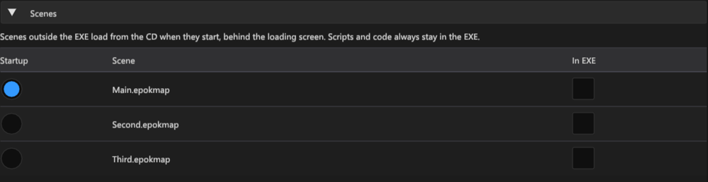
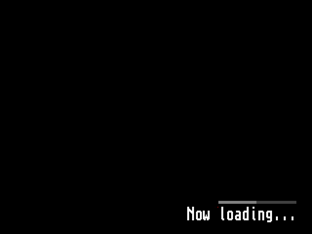

# Scenes outside the executable

By default every scene of a build is linked into the PS-X EXE: its actors,
meshes, collision, navigation, textures and the rest of its cooked data are in
RAM for the whole game, even while another scene is playing. A scene can
instead keep that data in its own file, `SCENEnn.BIN`, which the game reads
when the scene starts. All external scenes share one region of RAM, sized for
the largest of them, so a game can have more scenes than would fit in RAM
together.

Scripts and engine code always stay in the executable. Only data moves.

## The scene table

Open **Project Settings > Maps & Build > Scenes**. The table lists every saved
map in `assets/scenes`:

| Column | Meaning |
| --- | --- |
| Startup | The startup scene: it opens with the project and starts Whole Game builds. Same field as **Startup Scene** above it. |
| Scene | The map's path below `assets/scenes`. |
| In EXE | On: the scene's data is linked into the executable. Off: it is saved as a scene file and loaded when the scene starts. |

**New projects** start with every box off. **Projects created before this
table** behave as if every box were on, so nothing changes until you untick a
scene; the first change records the table in `.epokproject` with every other
scene still inside.

The table only matters when Play reads data from outside the executable:

| Play data | Scenes with In EXE off |
| --- | --- |
| In executable | Stay in the EXE: there is nowhere else to read them from. |
| CD on demand | Load from the CD image, through the same drive as XA music and geometry pages. |
| PC on demand | Load through PCDrv from the build folder (Play) or the package folder (Export PS-EXE). |

Native PC Play supports transitions between resident scene banks; it does not
read external scene files. **Export PS-EXE...** uses
the table too and adds each scene file to the ZIP beside `epok.ps-exe`.
**Export PsyQo Project** keeps every scene inside its executable.

## What happens at run time

When a script requests an external scene, the usual transition runs: the old
scene fades out with its audio and is torn down, and the loading screen
appears. The scene's file is then read into the shared region, and a bar above
the loading text shows the bytes read and checked so far. Only when the whole
file is in RAM and matches the size and checksum recorded in the executable
does the scene's load function run; then textures upload and the scene fades
in. An external startup scene loads the same way behind the boot loading
screen.

Entering the scene that already occupies the region (restarting it, or
returning to it with no other external scene in between) does not read the
file again. Scenes kept in the EXE never touch the region, so going from an
external scene to an internal one and back reads the file again only if
another external scene was loaded in between.

If the file is missing, has the wrong size, cannot be read or fails its
checksum, the loading screen shows **Load failed - START to retry** and
nothing of the new scene runs. START reads the file again. A file built for a
different executable always fails the check, so an old `SCENEnn.BIN` left
beside a new EXE cannot start.

No scene script runs while a file loads: the old scene has ended and the new
one has not started, so the loading screen itself shows the progress. The
`loading` field of **Scene > Snapshot** stays true until the scene has
started. For profilers and debuggers the runtime keeps `epok::scene_file_stats`
at a fixed address, like `epok::scene_stats`: loads, failures, bytes, the last
and longest load time in microseconds, the bytes checked of the current file,
the file in the region, and a `state` (idle, waiting, reading, ready, failed)
and `error` (none, record, drive, missing, size, read, checksum). Load time is
measured apart from frame timing: frames on the loading screen are not
gameplay frames.

## Memory

The memory report (**Build > Memory Analyzer**) shows the region as **External
scenes > Scene file region**, with each external scene and its size. The
region is as large as the largest scene file: the scene's data and an 8-byte
header, rounded up to 2 KiB. Each scene file appears under **Build files**.

Moving scenes out saves RAM when the scenes the executable no longer holds at
the same time are larger than the region and the loader (about 2 KiB of code):

- Two or more external scenes: the executable no longer holds all of them, and
  the region costs only the largest. This is the case the table is for.
- A single external scene: the region is as large as the data it replaced, so
  static RAM grows by the loader; only the EXE file gets smaller.
- Very small scenes (a camera and a few actors) can hold less data than the
  loader adds. Keep them in the EXE.

For example, two maps of the [Dungeon template](dungeon-template.md), each with
372 KiB of cooked data and textures, do not fit together in the executable: the
link overflows RAM by about 15 KB. With both outside, the build uses 1,818,624
bytes of static RAM, 15,504 bytes more than the same game with a single map
inside the EXE, and the executable shrinks from 840 KiB to 482 KiB. These are
build sizes; the loaded map renders the same frame as the one-map game in
PCSX-Redux. Reading one map from the emulated CD took 2.26 seconds including
the drive's start-up (about 300 KB/s once reading); hardware timing has not been
measured.

Some bytes of every scene stay in the executable: its code (the generated
setup functions and anything else compiled from it), its string literals
(actor and component names) and the per-bank texture descriptors. Textures move
with a scene only when no scene kept in the EXE and no Blueprint spawn template
uses them; a texture used by several external scenes is stored in each of
their files. Fonts, the loading image, audio and sound banks stay resident.

## Limits

- Up to 16 scenes per build, as before; each external scene adds one file.
- One external scene is in RAM at a time. There is no background preloading of
  the next scene: an external scene always loads behind the loading screen.
- PCDrv reads are synchronous and read 16 KiB per frame while the loading
  screen is shown. Over a serial link a file takes seconds to load (about 5.7
  seconds per 64 KiB at 115200 baud, calculated, not measured). The emulator
  serves PCDrv almost instantly, so emulator load times are not hardware times.
- On the CD, a scene file is read with the drive's normal data reads while the
  loading screen is shown. XA music is stopped by the transition before the read.
  Seek and read times measured in an emulator are not hardware times.
- Data that needs a constructor when the game boots cannot leave the
  executable; the build stops with a message naming the scene. Generated scene
  data is constant-initialized, so this only concerns custom code.
- Audio clips, sound banks and MusicSequence data stay resident; their SPU
  samples are uploaded when the game boots.
