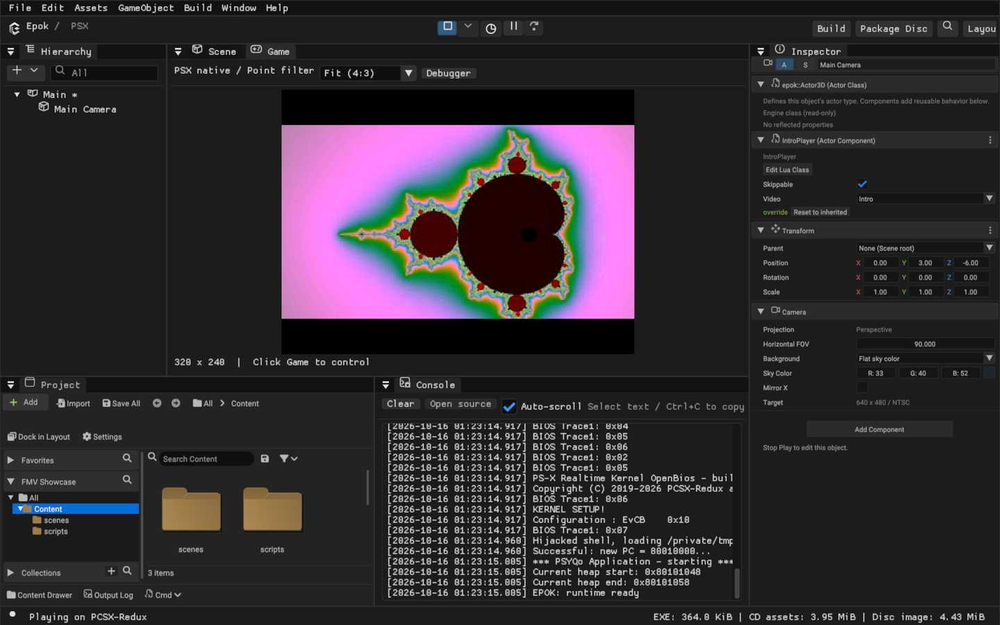
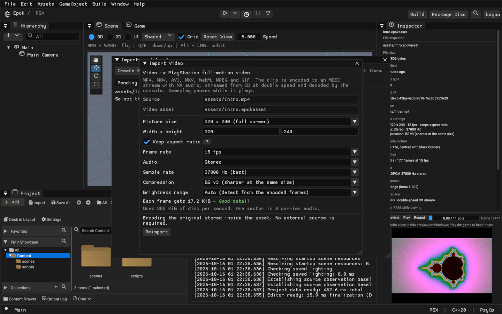
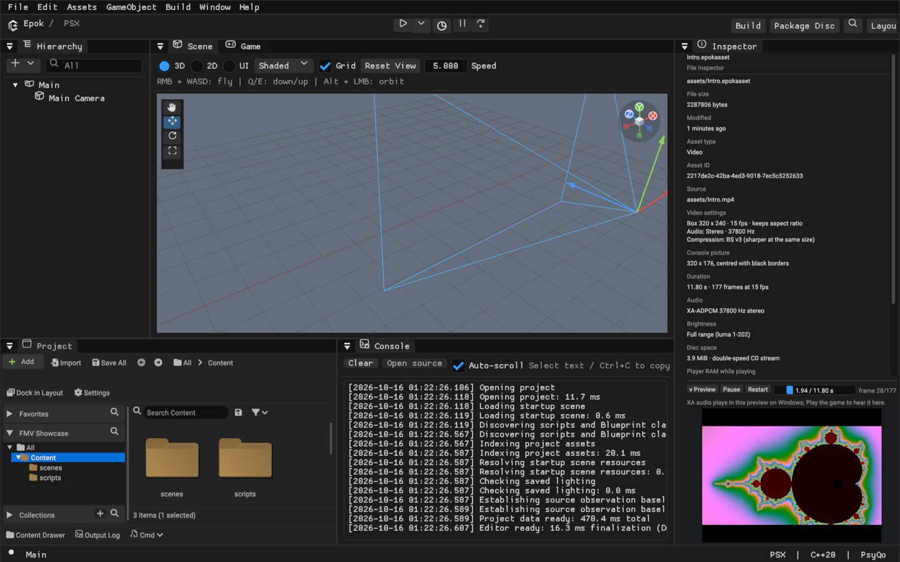

# Full-motion video

Epok plays full-screen video clips — intros, cutscenes, endings — the way
PlayStation games did: the clip streams from the CD at double speed, its audio
plays through the CD controller's XA decoder, and its frames are decompressed by
the console's MDEC straight into the frame buffer. Gameplay pauses while a clip
plays and continues afterwards.



<p align="center"><sub>Play in the real editor: the scene's <code>IntroPlayer</code> Lua component started the clip from <code>begin_play</code>. The console switched to 320 x 240 for the 16:9 clip and letterboxed it.</sub></p>

## Quick start

1. **Add the source.** Drag an MP4, MOV, M4V, AVI, MKV, WebM, MPEG, WMV, OGV
   or GIF file onto the Content browser (or use **Import**). The file is copied
   into the open folder and appears in **Imports**.
2. **Import it.** The **Import Video** dialog opens with sensible defaults
   (320 x 240, 15 fps, stereo). **Import** encodes the clip for the console
   and decodes every frame once with the console's own decoder, so a clip that
   cannot play never becomes an asset.
3. **Check it.** Select the new asset. The File Inspector lists the console
   picture size, duration, audio, brightness range, disc space and the RAM the
   player reserves. **Preview** plays the clip exactly as the console decodes
   it, at its 15-bit colour depth, centred on a PlayStation screen.
4. **Play it from gameplay.** Give a Blueprint or Lua class an
   `AssetRef<Video>` property and call **Play Video** (see below). The Inspector
   shows a picker listing the project's videos for that property.
5. **Use the CD.** Set **Play → Data** to **CD on demand** and press **Play**.
   Videos stream from the disc image Epok builds next to the executable.



## Playing a video

| Blueprint node (Video category) | Lua builtin | Result |
| --- | --- | --- |
| **Play video** (`Video`, `Skippable`) | `epok.play_video(self.<AssetRef<Video> property>, skippable)` | `Started`: `true` when the clip is queued |
| **Stop video** | `epok.stop_video()` | — |
| **Is video playing** | `epok.video_playing()` | `true` from the call that queued a clip until it has finished |

A Lua class that plays a clip when its actor starts:

```lua
---@class IntroPlayer : epok.ActorComponent
local IntroPlayer = epok.ActorComponent:extend()

-- The clip to show when the scene starts. Gameplay pauses while it plays.
IntroPlayer.video = epok.AssetRef("Video")
IntroPlayer.skippable = true

function IntroPlayer:begin_play()
    epok.play_video(self.video, self.skippable)
end

return IntroPlayer
```

Add the component to an actor and choose the clip in the Inspector's **Video**
picker. The same graph in a Blueprint is **Event Begin Play → Play video**, with
the clip chosen on the node's `Video` pin or from a Blueprint variable.

**What happens when.** *Play video* queues the clip and returns immediately; the
rest of the event runs in the same tick. From the next frame the player owns the
screen, the CD and the controller, and the game's simulation, rendering and
timers stand still. When the clip ends, the game continues where it was and its
clock skips the time the video took. So *Play video → Request scene* shows the
clip first and loads the next scene after it.

**Skipping.** With `Skippable` set, **START** or **✕** ends the clip early.
The button press does not reach gameplay.

**Background music** stops while a video plays and restarts from its beginning
afterwards, as it does when the CD is busy loading data.

Native C++ classes can call `epok::bp::api::play_video(id, skippable)`,
`stop_video()` and `video_playing()` from `blueprint_api.hpp`; the id is the
value of an `AssetRef<Video>` property declared by a Blueprint or Lua class.
Only videos that such properties or node pins reference are put on the disc.

## Import settings

| Setting | Default | Meaning |
| --- | --- | --- |
| Picture size | 320 x 240 | The box the picture is fitted into, in steps of 16 pixels, up to 320 x 240. Smaller pictures leave more data for each pixel. |
| Keep aspect ratio | On | The picture keeps its proportions inside the box and the console shows it with black borders. Off stretches it to fill the box. |
| Frame rate | 15 fps | 5 to 30 frames per second. The CD delivers a fixed amount of data each second, so more frames means less detail in each. |
| Audio | Stereo | Stereo, Mono or No audio. Without audio every sector carries video. |
| Sample rate | 37800 Hz | 18900 Hz halves the audio's share of the stream. |
| Compression | BS v3 | BS v3 codes brightness differences more compactly than BS v2 and is sharper at the same size. Both play. |
| Brightness range | Auto | See [Brightness range](#brightness-range). |

The dialog shows the data each frame gets at double speed and grades it. At the
defaults a frame gets 17.2 KiB:

| Audio | 10 fps | 15 fps | 24 fps | 30 fps |
| --- | --- | --- | --- | --- |
| Stereo 37800 Hz (one sector in 8) | 25.8 KiB | 17.2 KiB | 10.8 KiB | 8.6 KiB |
| Mono 37800 Hz or stereo 18900 Hz (one in 16) | 27.7 KiB | 18.5 KiB | 11.5 KiB | 9.2 KiB |
| No audio | 29.5 KiB | 19.7 KiB | 12.3 KiB | 9.8 KiB |

Encoding uses the pinned psxavenc. Epok reads the picture size from the
container (MP4/MOV, MKV/WebM, AVI, MPEG, Ogg Theora, GIF) and asks the encoder
for the exact letterboxed size; when the container does not say, the picture is
stretched to the box and the Inspector shows no source size. psxavenc keeps all
but the last frame or two of a clip.

From the command line (project-relative paths; settings are the same fields
as the dialog, in JSON):

```sh
epok-editor --project "My Game" --import-video assets/Intro.mp4
epok-editor --project "My Game" --import-video assets/Intro.mp4 --asset assets/Video/Intro.epokasset --video-settings '{"frame_rate":12,"audio":"mono","levels":"tv"}'
epok-editor --project "My Game" --reimport-asset assets/Video/Intro.epokasset --snapshot --video-settings '{"width":256,"height":192}'
```

`--import-video` prints the asset's UUID and the encode report: picture size,
frames, sectors, audio format, brightness levels and disc bytes.

**Edit video import settings** in the File Inspector re-encodes the stored
source with new settings and keeps the asset's identity, so references remain
valid. The asset stores the original file; the encoded stream is a cache under
`.epok/imported/` that Build recreates when needed.

### Brightness range

Most camera and web video stores black at 16 and white at 235 rather than 0 and
255. When the encoder passes such levels through unchanged (it does for a
source that already has the target size), the console would show grey blacks.
**Auto** measures the encoded frames and, when their darkest and brightest
pixels sit at those levels, marks the clip *TV range*. The player then expands
it to the full range at no runtime cost: AC steps grow in the MDEC's luma and
chroma quantisation tables and the decoder maps each block's DC value. Choose
**TV range** or **Full range** to override the detection. The Inspector reports
the measured levels.



## On the console

- **Stream.** Each referenced clip becomes `V#######.STR` on the disc: Mode 2
  sectors that interleave BS video frames (Form 1) with XA-ADPCM audio (Form 2),
  ending with a marker sector. 300 KiB of disc per second.
- **Playback.** The CD reads at double speed with XA audio routed to the SPU and
  only the clip's channel selected. Video sectors are assembled into frames in
  the CD interrupt. The CPU expands a frame's bitstream into MDEC codes, and the
  MDEC decodes it one 16-pixel column at a time; each column is uploaded to the
  frame buffer. Frames appear as soon as they have arrived, so picture and sound
  stay in step with the disc.
- **Display.** The player switches to a 320 x 240 mode (256 x 240 on 256-wide
  displays), keeps the interlace setting of 480-line displays so frame pacing is
  unchanged, centres the picture on black, and restores the game's mode at the
  end.
- **Memory.** A project that plays videos reserves one static buffer sized for
  its largest clip: two frames of assembly, the decoded codes and two pixel
  columns — typically 80 to 120 KiB at the defaults, more for detailed clips.
  The Inspector shows each clip's figure and the memory analysis counts the
  reserve. Projects without videos reserve nothing.
- **Statistics.** `epok::video_stats` reports the state, frames shown and
  dropped, sectors read, decode time in scanlines and the last error.

| `error_code` | Meaning |
| --- | --- |
| 1 | The CD drive did not initialise. |
| 2 | The stream file is not on the disc. |
| 3 | A CD command failed. |
| 4 | A sector of the wrong size or format arrived. |
| 5 | A frame failed to decode (`failed_frame` and `failed_status` name it). |
| 6 | The MDEC stopped responding. |
| 7 | No data arrived for three seconds. |

## Play data sources

Videos need the disc. **CD on demand** builds and mounts it. **In executable**
and **PC on demand** stop the build with a message naming the videos, because
their audio requires the CD controller. Serial builds keep the clip table but
put nothing on a disc; *Play video* then returns `false` and the game carries on.

## Limits

- One clip at a time, full screen only: there are no video textures on 3D or 2D
  surfaces, no looping and no seeking.
- Pictures are at most 320 x 240 and shown in 15-bit colour.
- The CPU expands every frame's bitstream, so very detailed clips take longer.
  The Inspector estimates the console's decode time for the most detailed frame
  and warns when it approaches the time between frames; a frame that is not
  ready in time is skipped (`frames_dropped`). A dense 320 x 176 clip at 15 fps
  measures about 63 ms of the 67 ms available in PCSX-Redux.
- Streams are encoded for double-speed CD.
- The Inspector preview plays audio on Windows; elsewhere it is silent and the
  game's Play has sound.

## Testing

`tests/integration/verify_fmv.py` creates a project with an original test clip,
plays it from a Lua class, builds the disc and runs it in PCSX-Redux. It checks
that every frame is shown in real time without errors, that the picture and its
borders have the expected colours vsync by vsync, that the game's display mode
returns and that **START** skips the clip. Run it with
`--display 640x480` (the default) or `--display 320x240`.
